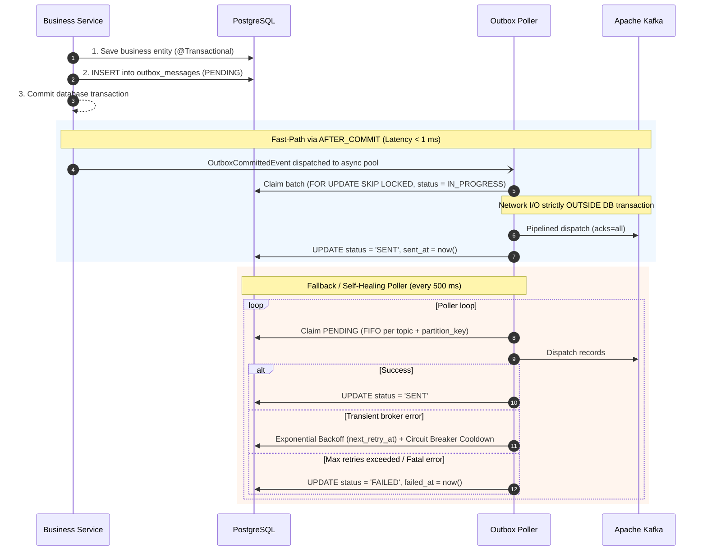
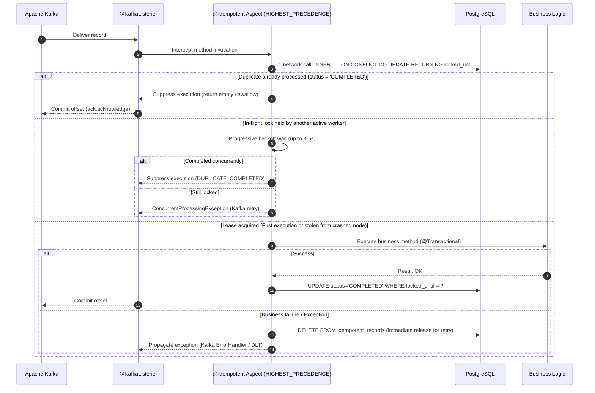

<div align="center">

# Idembox

**Transactional Outbox and Idempotent Consumer for Spring Boot 3 on PostgreSQL and Apache Kafka. At-Least-Once delivery on producer, Exactly-Once processing on consumer. Zero external infrastructure.**

<p align="center">
  <a href="LICENSE"></a>
  <a href="#requirements"></a>
  <a href="#requirements"></a>
  <a href="#requirements"></a>
  <a href="#requirements"></a>
  <a href="#tests"></a>
</p>

**English** ·
[Русский](docs/readme/README.ru.md) ·
[Deutsch](docs/readme/README.de.md) ·
[Español](docs/readme/README.es.md) ·
[中文](docs/readme/README.zh.md)

<p align="center">
  <a href="#what-it-does">What it does</a> •
  <a href="#how-it-works">How it works</a> •
  <a href="#requirements">Requirements</a> •
  <a href="#quick-start-sample-service">Quick Start</a> •
  <a href="#integrating-into-your-project">Integration</a> •
  <a href="#configuration-applicationyml">Configuration</a> •
  <a href="#production-hardening--architecture">Architecture</a> •
  <a href="#monitoring-and-metrics">Metrics</a>
</p>

</div>

---

**Idembox** solves the classic **Dual-Write** and **message duplication** problems in distributed Spring Boot microservices.

Saving business entities to PostgreSQL and publishing events to Kafka are combined into an atomic database transaction via the **Transactional Outbox** pattern, while inbound Kafka messages are guaranteed to execute business logic strictly once via the declarative **`@Idempotent`** consumer aspect.

No dedicated Debezium clusters, no Kafka Connect nodes, and no heavy runtime dependencies. Everything runs natively inside your Spring Boot application using your existing PostgreSQL and Kafka connections, delivering sub-millisecond dispatch on the hot path (**Fast-Path**) with full resilience against network outages and pod crashes.

---

<a id="what-it-does"></a>
## What it does

- **Eliminates Dual-Write discrepancies** — business entities and Outbox messages commit together in a single ACID transaction in PostgreSQL; rolling back the business transaction guarantees no phantom event reaches the broker.
- **Dispatches instantly via Fast-Path (< 1 ms)** — the `AFTER_COMMIT` transaction trigger offloads events to an asynchronous thread pool for immediate broker dispatch without waiting for poller intervals.
- **Guarantees strict FIFO per partition key** — for any given `(topic, partition_key)`, the poller never claims or sends two messages concurrently, preserving causal ordering across worker restarts.
- **Decouples broker network I/O from database transactions** — Kafka publishing executes outside database transactions via a dedicated non-transactional `KafkaTemplate`, protecting HikariCP pools from network latency.
- **Pipelined parallel dispatch** — independent keys within a claimed batch are published concurrently, reaching thousands of events per second without Head-of-Line blocking.
- **Deduplicates consumer events in 1 SQL round-trip** — the `@Idempotent` aspect claims execution leases atomically using `INSERT ... ON CONFLICT DO UPDATE ... RETURNING locked_until` in a single network round-trip.
- **Connection pool deadlock immunity** — configured with `Ordered.HIGHEST_PRECEDENCE`, lease acquisition commits in an isolated `PROPAGATION_REQUIRES_NEW` transaction and releases the connection **before** `@Transactional` opens the business connection ($1 \rightarrow 0 \rightarrow 1 \rightarrow 0$).
- **Crash Recovery for failed worker nodes** — separates worker in-flight leases (`lockTimeout = 2m`) from long-term deduplication windows (`ttl = 7d`). If a worker pod crashes mid-execution (OOM, SIGKILL), another pod safely steals the lease once expired.
- **Split-Brain protection via Fencing Token** — completion updates require matching lease deadlines (`WHERE locked_until = ?`), preventing late workers after long GC pauses from overwriting active leases.
- **Safe duplicate suppression (`swallowDuplicate`)** — returns empty containers (`Optional.empty()`, `Collections.emptyList()`, completed future) instead of throwing `NullPointerException`.
- **Manual offset commit support (`AckMode.MANUAL` & `Message<?>`)** — automatically retrieves `Acknowledgment` and commits Kafka offsets when suppressing duplicate deliveries.
- **Automated deadlock-free housekeeping** — background cleaners coordinate across nodes using PostgreSQL advisory locks and delete expired rows in chunks (`LIMIT 5000 SKIP LOCKED`), avoiding Table Bloat.
- **Production Micrometer metrics out-of-the-box** — publish latency timers, duplicate counters, queue lag gauges, and copy-pasteable Prometheus alert rules.

---

<a id="how-it-works"></a>
## How it works

```
Business Service  →  @Transactional save  →  Table outbox_messages (PENDING)
                  →  AFTER_COMMIT trigger  →  Kafka Producer (acks=all)  [Fast-Path < 1 ms]
                  →  Fallback Poller (SKIP LOCKED)  →  Automated failure recovery
                  →  @KafkaListener  →  @Idempotent (UPSERT lease)  →  Business logic (strictly once)
```

### Transactional Outbox Lifecycle:


### Idempotent Consumer Lifecycle:


---

<a id="requirements"></a>
## Requirements

| Component       | Requirement                                                |
|-----------------|------------------------------------------------------------|
| **Java**        | 17 or newer                                                |
| **Spring Boot** | 3.0.0 – 3.4.x                                              |
| **PostgreSQL**  | 13+ (supports `jsonb`, `SKIP LOCKED`, `advisory locks`)    |
| **Apache Kafka**| 3.0+                                                       |
| **Build tools** | Maven 3.8+ (or included `./mvnw`), Docker & Docker Compose |

---

<a id="quick-start-sample-service"></a>
## Quick Start (Sample Service)

The repository includes a ready-to-run demo microservice [`samples/sample-order-service`](samples/sample-order-service) demonstrating the full workflow: REST API $\rightarrow$ Transactional Outbox $\rightarrow$ Apache Kafka $\rightarrow$ Idempotent Consumer.

### Step 1. Clone the repository and enter the sample directory

```bash
git clone https://github.com/litvinov-alex/Idembox.git
cd Idembox/samples/sample-order-service
```

### Step 2. Start PostgreSQL and Kafka via Docker Compose

This starts PostgreSQL 16 (port 5432) and Apache Kafka 3.8 in KRaft mode (port 9092) with configured health checks:

```bash
docker-compose up -d
```

Verify that both containers are healthy:
```bash
docker-compose ps
```

### Step 3. Build and run the sample microservice

```bash
# On Linux / macOS:
../../mvnw spring-boot:run

# On Windows (PowerShell):
..\..\mvnw.cmd spring-boot:run
```

During startup, the service will:
1. Apply the database schema migrations via Flyway.
2. Connect to Kafka and initialize the consumer for the `order-events` topic.
3. Start the Outbox poller and housekeeping scheduled tasks.

### Step 4. Verify service health

In another terminal, check Actuator health:

```bash
curl -s http://localhost:8080/actuator/health
```

Expected output:
```json
{"status":"UP"}
```

---

### Step 5. Step-by-Step Scenario Testing

#### 1. Create an order and trigger Outbox publishing
Send a POST request with a unique idempotency key:

```bash
curl -i -X POST "http://localhost:8080/api/orders?customerId=cust-101&amount=450.00" \
  -H "Idempotency-Key: order-req-001"
```

Response:
```http
HTTP/1.1 200 OK
Content-Type: application/json

{
  "orderId": "ORD-6f1c4e20-7b3a-4a61-9c42-88d3e91b5a2b",
  "message": "Order persisted and transactional Outbox event published to Kafka!",
  "status": "CREATED"
}
```

What happened under the hood:
1. The service saved the order into `orders` and inserted an event into `outbox_messages` with status `PENDING` in a single transaction.
2. Upon commit, `AFTER_COMMIT` dispatched the record to Kafka via the asynchronous Fast-Path.
3. The poller marked the record as `SENT`.
4. `@KafkaListener` consumed the event, `@Idempotent` acquired the lease, processed the payment, and saved status `COMPLETED` in `idempotent_records`.

#### 2. Inspect PostgreSQL database state

Check the Outbox table:
```bash
docker exec -it sample-postgres psql -U postgres -d orders_db -c \
  "SELECT id, topic, status, retry_count, sent_at FROM outbox_messages;"
```

Output:
```text
                  id                  |    topic     | status | retry_count |            sent_at            
--------------------------------------+--------------+--------+-------------+-------------------------------
 01926b48-1234-7abc-8def-0123456789ab | order-events | SENT   |           0 | 2026-10-14 15:30:00.123456+00
(1 row)
```

Check the idempotency records table:
```bash
docker exec -it sample-postgres psql -U postgres -d orders_db -c \
  "SELECT consumer_group, event_key, status, completed_at FROM idempotent_records;"
```

Output:
```text
     consumer_group    |              event_key               |  status   |         completed_at          
-----------------------+--------------------------------------+-----------+-------------------------------
 payment-service-group | ORD-6f1c4e20-7b3a-4a61-9c42-88d3e91b | COMPLETED | 2026-10-14 15:30:00.245123+00
(1 row)
```

#### 3. Test HTTP Ingress Deduplication
Re-send the exact same request with the same `Idempotency-Key`:

```bash
curl -i -X POST "http://localhost:8080/api/orders?customerId=cust-101&amount=450.00" \
  -H "Idempotency-Key: order-req-001"
```

Response:
```http
HTTP/1.1 200 OK
Content-Type: application/json

{
  "orderId": "ORD-6f1c4e20-7b3a-4a61-9c42-88d3e91b5a2b",
  "message": "Order already exists, duplicate ignored",
  "status": "EXISTS"
}
```
*Result:* No duplicate order was created, no duplicate event was published to Kafka, and the existing `orderId` was safely returned.

#### 4. Test Kafka Consumer Deduplication (`@Idempotent`)
Check application logs to observe successful initial processing:
```text
INFO  [payment-service-group-0-C-1] i.g.a.s.c.PaymentOrderConsumer : Successfully charged payment for order ORD-6f1c4e20... amount: 450.00
```
If a duplicate event is replayed in Kafka, the `@Idempotent` aspect intercepts it in 1 SQL query, skips execution, and commits the offset.

#### 5. Check Prometheus metrics
Inspect Idembox metrics via Actuator:

```bash
curl -s http://localhost:8080/actuator/prometheus | grep idembox
```

Sample output:
```text
idembox_outbox_messages_enqueued_total{topic="order-events"} 1.0
idembox_outbox_messages_sent_total{topic="order-events"} 1.0
idembox_outbox_publish_latency_seconds_count{topic="order-events"} 1.0
idembox_outbox_messages_pending 0.0
idembox_idempotent_executions_total{group="payment-service-group",result="acquired"} 1.0
```

### Step 6. Stop demo environment

```bash
# Stop application: Ctrl+C in the terminal

# Tear down Docker containers and data volumes:
docker-compose down -v
```

---

<a id="integrating-into-your-project"></a>
## Integrating into Your Project

### 1. Add dependency

#### Maven (`pom.xml`):
```xml
<dependency>
    <groupId>io.github.litvinov-alex</groupId>
    <artifactId>idembox-spring-boot-starter</artifactId>
    <version>0.1.0</version>
</dependency>
```

#### Gradle (`build.gradle`):
```groovy
implementation 'io.github.litvinov-alex:idembox-spring-boot-starter:0.1.0'
```

---

### 2. Apply database migrations

The starter provides a verified DDL schema with covering partial indexes: [`schema-postgresql.sql`](idembox-spring-boot-starter/src/main/resources/db/migration/idembox/schema-postgresql.sql).

#### Option A: Flyway integration (Recommended)
Add the starter schema location in `application.yml`:
```yaml
spring:
  flyway:
    locations:
      - classpath:db/migration            # Your business migrations
      - classpath:db/migration/idembox  # Idembox schema
```
*Or* copy the SQL file into your service migrations folder as `V2__init_idembox.sql`.

#### Option B: Liquibase integration
Include the file in your `db.changelog-master.yaml`:
```yaml
databaseChangeLog:
  - include:
      file: db/migration/idembox/schema-postgresql.sql
```

---

### 3. Publishing events (Transactional Outbox)

Inject `OutboxPublisher` into your service and publish inside `@Transactional` methods:

```java
@Service
public class OrderService {

    private final OrderRepository orderRepository;
    private final OutboxPublisher outboxPublisher;

    public OrderService(OrderRepository orderRepository, OutboxPublisher outboxPublisher) {
        this.orderRepository = orderRepository;
        this.outboxPublisher = outboxPublisher;
    }

    @Transactional
    public Order createOrder(CreateOrderCommand cmd) {
        // 1. Mutate domain state in PostgreSQL
        Order order = orderRepository.save(new Order(cmd));

        // 2. Atomically enqueue event in Outbox
        outboxPublisher.publish(
            "order-events",                  // Kafka topic
            order.getId().toString(),         // Partition key (preserves FIFO order)
            new OrderCreatedEvent(order.getId(), order.getCustomerId(), order.getAmount())
        );

        return order;
    }
}
```

---

### 4. Idempotent processing (Idempotent Consumer)

Annotate your `@KafkaListener` method with `@Idempotent`:

```java
@Component
public class PaymentOrderConsumer {

    private final PaymentProcessor paymentProcessor;

    public PaymentOrderConsumer(PaymentProcessor paymentProcessor) {
        this.paymentProcessor = paymentProcessor;
    }

    @KafkaListener(topics = "order-events", groupId = "payment-service-group")
    @Idempotent(
        key = "#root.args[0].orderId",       // SpEL expression extracting unique business key
        consumerGroup = "payment-service",   // Logical group name (auto-generated if omitted)
        ttl = "7d",                          // Deduplication retention window
        lockTimeout = "2m",                  // Worker in-flight lease duration
        swallowDuplicate = true              // Suppress duplicates without throwing exception
    )
    public void onOrderCreated(OrderCreatedEvent event, Acknowledgment ack) {
        // Business logic runs strictly ONCE per orderId
        paymentProcessor.charge(event.orderId(), event.amount());
        ack.acknowledge();
    }
}
```

---

<a id="configuration-applicationyml"></a>
## Configuration (`application.yml`)

All configuration parameters are validated at startup via JSR-380:

```yaml
idembox:
  initialize-schema: false         # Auto-run DDL on startup (false in production)
  table-schema: ""                 # Optional table schema (e.g. table-schema: my_schema)
  table-prefix: ""                 # Optional table prefix
  scheduler-pool-size: 4           # Thread pool size for poller and cleaners

  outbox:
    enabled: true                  # Enable Outbox publisher and poller
    poller:
      enabled: true                # Enable background polling worker (false for pure API pods)
      rate-ms: 500                 # Polling rate in milliseconds
    batch-size: 50                 # Batch size when using FOR UPDATE SKIP LOCKED
    max-drain-batches: 10          # Maximum consecutive batches to drain without pauses
    immediate-flush: true          # Fast-Path dispatch on AFTER_COMMIT event
    send-timeout: 10s              # Kafka send acknowledgment timeout
    max-payload-size: 1MB          # Guard against oversized payloads (protects TOAST and RAM)
    retention: 7d                  # Retention period for sent messages before cleanup
    failed-retention: 30d          # Retention period for permanently failed messages
    max-retries: 5                 # Maximum delivery attempts before moving to FAILED
    initial-backoff: 1s            # Initial retry backoff
    max-backoff: 10m               # Maximum exponential backoff
    backoff-multiplier: 2.0        # Exponential multiplier
    in-progress-lock-duration: 5m  # Worker lease timeout for IN_PROGRESS messages
    broker-cooldown: 10s           # Circuit breaker pause upon broker network outage
    preserve-creation-timestamp: false # true = transmit created_at to Kafka, false = broker time
    add-type-id-header: true       # Transmit __TypeId__ header with Java class name
    cleanup-cron: "0 0 * * * *"    # Hourly cleanup schedule for sent and failed messages
    cleaner:
      enabled: true
      batch-size: 5000             # Chunk size for vacuum-friendly batch deletions
      max-batches-per-run: 100     # Maximum chunks to delete per run

  idempotency:
    enabled: true                  # Enable @Idempotent AOP aspect
    default-ttl: "7d"              # Default deduplication TTL (formats: 7d, 24h, 30m, ISO-8601)
    default-lock-timeout: "2m"     # In-flight lease timeout for crash recovery
    in-flight-wait-timeout: 3s     # Maximum wait for concurrent in-flight executions
    fail-on-existing-transaction: true # Fail-fast guard against connection pool starvation
    fail-on-condition-error: true  # Fail on SpEL condition evaluation errors
    cleanup-cron: "0 0 * * * *"    # Hourly cleanup schedule for expired keys
    cleaner:
      enabled: true
      batch-size: 5000
      max-batches-per-run: 100

  metrics:
    enabled: true                  # Export metrics to Micrometer / Prometheus
```

---

<a id="production-hardening--architecture"></a>
## Production Hardening & Architecture

### 1. Commit Order Anomaly in PostgreSQL (READ COMMITTED)
Under PostgreSQL's default `READ COMMITTED` isolation level, two concurrent transactions modifying the same aggregate may commit out of wall-clock order:
* Transaction A starts at $T_1$, inserts Outbox event 1 (`created_at = T_1`), but takes time and commits at $T_4$.
* Transaction B starts at $T_2$, inserts Outbox event 2 (`created_at = T_2`), and commits quickly at $T_3$ ($T_3 < T_4$).
* The poller running between $T_3$ and $T_4$ claims event 2 and sends it to Kafka before event 1.

> [!IMPORTANT]
> **Engineering Rule for Strict FIFO Ordering:**
> This is a fundamental property of MVCC relational databases. If strict chronological ordering of events for an aggregate is required, **business code must serialize entity mutations using pessimistic locking**:
> ```java
> Order order = orderRepository.findByIdForUpdate(orderId); // SELECT ... FOR UPDATE
> ```
> This guarantees transaction commit order strictly matches business causality.

---

### 2. HikariCP Connection Pool Deadlock Immunity
* **Sequential connection acquisition:** Because `@Idempotent` runs at `Ordered.HIGHEST_PRECEDENCE`, lease acquisition executes in an isolated `PROPAGATION_REQUIRES_NEW` transaction that commits and **returns its connection to HikariCP BEFORE** entering `@Transactional`. Connections are requested sequentially ($1 \rightarrow 0 \rightarrow 1 \rightarrow 0$), preventing connection pool deadlocks.
* **Dedicated connection pool:** Under heavy workloads, you can isolate library queries into a separate pool. The starter binds automatically if a bean named `idemboxDataSource` or `idemboxJdbcTemplate` is defined:
  ```java
  @Bean
  @Qualifier("idemboxDataSource")
  public DataSource idemboxDataSource() {
      HikariConfig config = new HikariConfig();
      config.setJdbcUrl("jdbc:postgresql://localhost:5432/orders_db");
      config.setMaximumPoolSize(10); // Dedicated 5-10 connection pool
      return new HikariDataSource(config);
  }
  ```

---

### 3. Duplicate Return Values (`swallowDuplicate`)
When `@Idempotent` suppresses a duplicate for a non-void method (`swallowDuplicate = true`):
* `Optional<T>` $\rightarrow$ returns `Optional.empty()`.
* Collections (`List`, `Set`, `Map`) $\rightarrow$ returns immutable empty collections (`emptyList()`, `emptySet()`, `emptyMap()`).
* `CompletableFuture<T>` $\rightarrow$ returns `completedFuture(null)`.
* Primitives $\rightarrow$ returns default primitive values (`0`, `false`).
* Custom DTOs (e.g. `PaymentResult`) $\rightarrow$ returns `null`.

> [!TIP]
> If caller code expects a non-null object, return `Optional<MyResult>` or configure `swallowDuplicate = false` (throws `DuplicateMessageException` to be handled by your error handler).

---

### 4. Single-Record Consumer Guard
`@Idempotent` is strictly designed for single-record consumer methods (`ConsumerRecord`, POJO, `Message<?>`). Annotating a batch listener method (`List<ConsumerRecord>` or `Collection<T>`) will trigger a `BeanInitializationException` at application startup via `IdempotentStartupValidator`. For batch processing, use programmatic calls to `IdempotentRepository.tryAcquire(...)`.

---

### 5. Kafka Producer Ordering Configuration
To preserve strict partition ordering during producer retries:
* In Kafka 3.x+, producer idempotence is enabled by default (`enable.idempotence = true`).
* Ensure your application producer settings include:
  ```yaml
  spring:
    kafka:
      producer:
        acks: all
        properties:
          enable.idempotence: true
          max.in.flight.requests.per.connection: 5
  ```

---

### 6. PostgreSQL Autovacuum & Throughput (5,000+ msg/s)
The Outbox queue lifecycle (`INSERT` $\rightarrow$ `UPDATE` $\rightarrow$ `DELETE`) produces dead tuples in PostgreSQL MVCC. Apply the tuning parameters from [`dba-tuning-postgresql.sql`](idembox-spring-boot-starter/src/main/resources/db/migration/idembox/dba-tuning-postgresql.sql) to prevent Table Bloat:

```sql
ALTER TABLE outbox_messages SET (
    autovacuum_vacuum_scale_factor = 0.05,
    autovacuum_vacuum_cost_limit = 1000
);

ALTER TABLE idempotent_records SET (
    autovacuum_vacuum_scale_factor = 0.05,
    autovacuum_vacuum_cost_limit = 1000
);
```

> [!NOTE]
> **Scale boundaries:**
> Table-based Outbox on PostgreSQL comfortably handles workloads up to **5,000 – 7,000 messages per second** on standard database nodes. For sustained throughput exceeding **10,000 msg/s**, transitioning to Debezium CDC (PostgreSQL WAL streaming) is recommended.

---

<a id="monitoring-and-metrics"></a>
## Monitoring and Metrics

Metrics are automatically registered in Micrometer / Prometheus:

| Metric                                     | Type    | Description                                              | Tags                                                               |
|--------------------------------------------|---------|----------------------------------------------------------|--------------------------------------------------------------------|
| `idembox.outbox.messages.enqueued`         | Counter | Total messages written to Outbox table                   | `topic`                                                            |
| `idembox.outbox.messages.sent`             | Counter | Messages successfully delivered to Kafka                 | `topic`                                                            |
| `idembox.outbox.publish.latency`           | Timer   | Kafka publish and acknowledgment latency                 | `topic`                                                            |
| `idembox.outbox.messages.failed`           | Counter | Transient broker dispatch failures                       | `topic`                                                            |
| `idembox.outbox.messages.terminal.failures`| Counter | Terminal failures (status `FAILED` / Poison Pills)       | `topic`                                                            |
| `idembox.outbox.messages.pending`          | Gauge   | Current size of pending backlog in Outbox                | —                                                                  |
| `idembox.outbox.leases.stolen`             | Counter | Stolen poller leases from crashed instances              | `topic`                                                            |
| `idembox.idempotent.executions`            | Counter | Idempotent consumer executions by outcome                | `group`, `result` (`acquired`, `duplicate`, `failed`, `concurrent_retry`) |
| `idembox.idempotent.lease_stolen`          | Counter | Consumer leases stolen from crashed pods                 | `group`                                                            |

### Prometheus Alertmanager Rules:

```yaml
- alert: OutboxQueueBacklogHigh
  expr: idembox_outbox_messages_pending > 1000
  for: 3m
  labels:
    severity: warning
  annotations:
    summary: "Outbox backlog is growing on {{ $labels.instance }}"

- alert: OutboxTerminalFailuresDetected
  expr: rate(idembox_outbox_messages_terminal_failures_total[5m]) > 0
  for: 1m
  labels:
    severity: critical
  annotations:
    summary: "Outbox messages are permanently failing (Poison Pills)"

- alert: OutboxPublishLatencyHigh
  expr: histogram_quantile(0.99, sum(rate(idembox_outbox_publish_latency_seconds_bucket[5m])) by (le, topic)) > 2
  for: 2m
  labels:
    severity: warning
  annotations:
    summary: "Kafka publish latency p99 exceeds 2s for topic {{ $labels.topic }}"
```

---

<a id="tests"></a>
## Tests

The project includes an exhaustive suite of **366 unit and integration tests** validating behavior under network failures, rebalances, and pod crashes using real PostgreSQL and Kafka Testcontainers:

```bash
# Run the full test suite:
./mvnw test
```

---

<a id="project-structure"></a>
## Project Structure

| Module                                                      | Description                                                                                                                           |
|-------------------------------------------------------------|---------------------------------------------------------------------------------------------------------------------------------------|
| [`idembox-core`](idembox-core)                              | Domain interfaces, models (`OutboxMessage`, `ProcessingState`), SpEL key extractor, and `@Idempotent` annotation. Zero dependencies. |
| [`idembox-spring-boot-starter`](idembox-spring-boot-starter) | Spring Boot 3 autoconfiguration, AOP aspect, high-performance PostgreSQL JDBC repositories, OutboxPoller, and Testcontainers tests.   |
| [`samples/sample-order-service`](samples/sample-order-service) | Sample order service with Flyway migrations, REST API, and `docker-compose.yml`.                                                   |

---

<a id="license"></a>
## License

This project is licensed under the **Apache 2.0 License**. See [LICENSE](LICENSE) for details.
