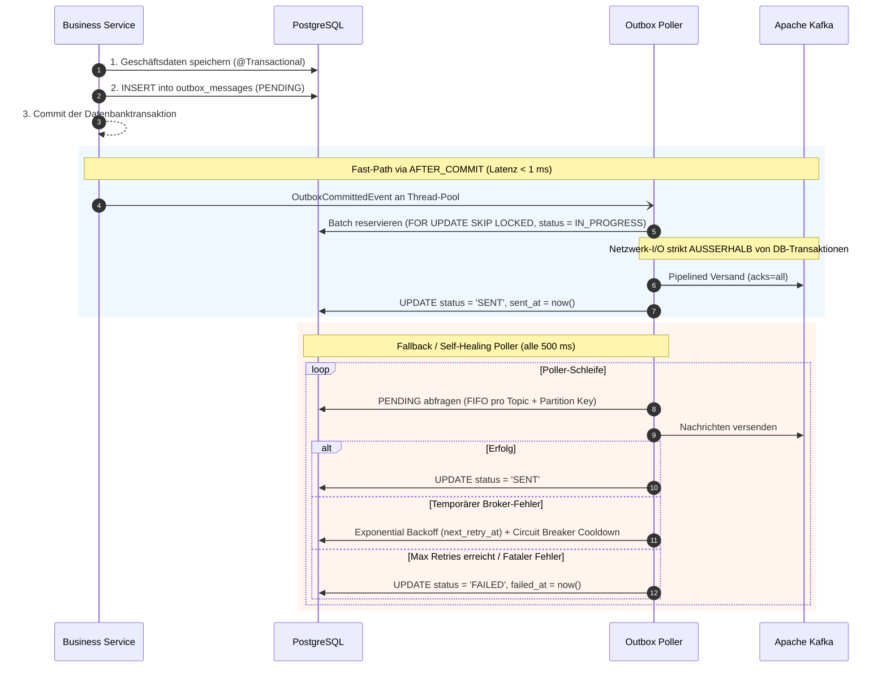
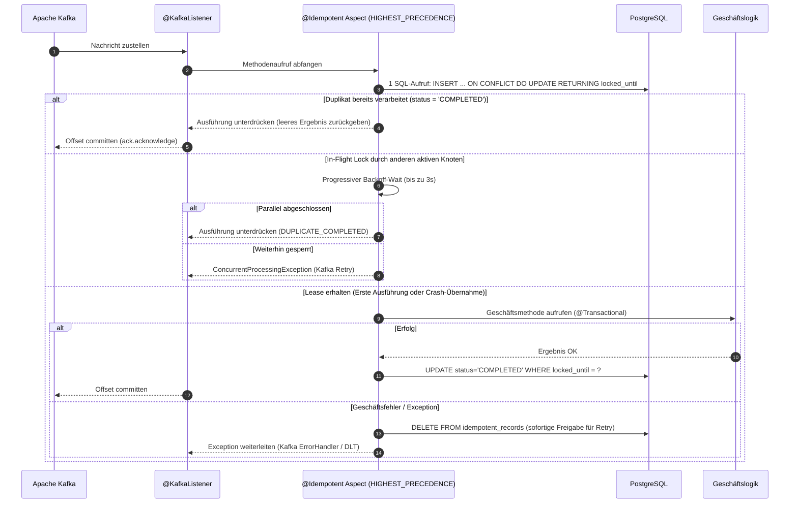

<div align="center">

# Idembox

**Transactional Outbox und Idempotent Consumer für Spring Boot 3 auf PostgreSQL und Apache Kafka. At-Least-Once-Zustellung auf Producer-Seite, Exactly-Once-Verarbeitung auf Consumer-Seite. Ohne externe Infrastruktur.**

<p align="center">
  <a href="../../LICENSE"></a>
  <a href="#anforderungen"></a>
  <a href="#anforderungen"></a>
  <a href="#anforderungen"></a>
  <a href="#anforderungen"></a>
  <a href="#tests"></a>
</p>

[English](../../README.md) ·
[Русский](README.ru.md) ·
**Deutsch** ·
[Español](README.es.md) ·
[中文](README.zh.md)

<p align="center">
  <a href="#kernfunktionen">Kernfunktionen</a> •
  <a href="#funktionsweise">Funktionsweise</a> •
  <a href="#anforderungen">Anforderungen</a> •
  <a href="#schnellstart-beispieldienst">Schnellstart</a> •
  <a href="#integration-in-ihr-projekt">Integration</a> •
  <a href="#konfiguration-applicationyml">Konfiguration</a> •
  <a href="#produktionshärtung--architektur">Architektur</a> •
  <a href="#überwachung-und-metriken">Metriken</a>
</p>

</div>

---

**Idembox** löst das klassische **Dual-Write**- und **Nachrichten-Duplizierungs**-Problem in verteilten Spring Boot Microservice-Architekturen.

Geschäftsdaten und Outbox-Ereignisse werden in einer einzigen ACID-Transaktion in PostgreSQL gespeichert (**Transactional Outbox**-Muster), während eingehende Nachrichten über den deklarativen Aspekt **`@Idempotent`** garantiert exakt einmal verarbeitet werden.

Keine separaten Debezium-Cluster, kein Kafka Connect und keine externen Laufzeit-Abhängigkeiten. Alles läuft nativ in Ihrer Spring Boot-Anwendung auf Basis bestehender PostgreSQL- und Kafka-Verbindungen.

---

## Kernfunktionen

- **Beseitigt Dual-Write-Inkonsistenzen** — Geschäftsdaten und Outbox-Einträge committen atomar in PostgreSQL; bei einem Transaktions-Rollback gelangt niemals ein Geister-Event an den Broker.
- **Fast-Path-Versand (< 1 ms)** — `AFTER_COMMIT`-Trigger versendet Nachrichten sofort asynchron an Kafka, ohne auf den nächsten Poller-Durchlauf zu warten.
- **Strikte FIFO-Garantie pro Partition-Key** — Für denselben Key `(topic, partition_key)` werden niemals zwei Nachrichten parallel verarbeitet oder versendet.
- **Isolierter Netzwerk-I/O** — Kafka-Aufrufe finden strikt außerhalb von Datenbanktransaktionen statt, um HikariCP-Verbindungspools vor Netzwerklatenzen zu schützen.
- **Pipelined paralleler Versand** — Unabhängige Keys innerhalb eines Batches werden parallel versendet, was Tausende Events pro Sekunde ohne Head-of-Line Blocking ermöglicht.
- **Atomare Lease-Akquise in 1 SQL Round-Trip** — `@Idempotent` holt Locks via `INSERT ... ON CONFLICT DO UPDATE ... RETURNING locked_until` in einer einzigen Anfrage.
- **Deadlock-Immunität im Verbindungspool** — Ausführung mit `Ordered.HIGHEST_PRECEDENCE`: Lease-Akquise committet in `PROPAGATION_REQUIRES_NEW` und schließt die Verbindung **vor** dem Öffnen der `@Transactional`-Geschäftstransaktion ($1 \rightarrow 0 \rightarrow 1 \rightarrow 0$).
- **Crash Recovery für ausgefallene Instanzen** — Trennung von Lease-Lock (`lockTimeout = 2m`) und Deduplizierungs-TTL (`ttl = 7d`). Fällt ein Pod bei der Bearbeitung aus, übernimmt ein anderer Knoten nach Ablauf des Leases.
- **Split-Brain-Schutz durch Fencing Token** — Abschluss-Updates prüfen den Lease-Zeitstempel (`WHERE locked_until = ?`), wodurch späte Threads nach GC-Pausen keine fremden Locks überschreiben.
- **Sichere Duplikatsunterdrückung (`swallowDuplicate`)** — Gibt leere Container (`Optional.empty()`, leere Listen, abgeschlossene Futures) zurück statt `NullPointerException`.
- **Manuelles Offset-Commit** — Unterstützt `AckMode.MANUAL` & `Message<?>` und committet Offsets bei Duplikaten automatisch.
- **Bereinigung ohne Deadlocks** — Periodisches Löschen abgelaufener Datensätze über PostgreSQL Advisory Locks (`LIMIT 5000 SKIP LOCKED`) zur Vermeidung von Table Bloat.
- **Micrometer- und Prometheus-Metriken out-of-the-box** — Latenz-Timer, Duplikatzähler, Queue-Lag-Gauges und fertige Alertmanager-Regeln.

---

## Funktionsweise

```
Business Service  →  @Transactional save  →  Tabelle outbox_messages (PENDING)
                  →  AFTER_COMMIT Trigger  →  Kafka Producer (acks=all)  [Fast-Path < 1 ms]
                  →  Fallback Poller (SKIP LOCKED)  →  Automatische Wiederherstellung
                  →  @KafkaListener  →  @Idempotent (UPSERT Lease)  →  Geschäftslogik (exakt 1x)
```

### Transactional Outbox Lebenszyklus:


### Idempotent Consumer Lebenszyklus:


---

## Anforderungen

| Komponente | Anforderung |
|---|---|
| **Java** | 17 oder neuer |
| **Spring Boot** | 3.0.0 – 3.4.x |
| **PostgreSQL** | 13+ (unterstützt `jsonb`, `SKIP LOCKED`, `advisory locks`) |
| **Apache Kafka** | 3.0+ |
| **Build-Tools** | Maven 3.8+ (oder beiliegendes `./mvnw`), Docker & Docker Compose |

---

## Schnellstart (Beispieldienst)

Das Repository enthält einen sofort lauffähigen Demonstrations-Microservice [`samples/sample-order-service`](../../samples/sample-order-service/):

### Schritt 1. Repository klonen und in das Verzeichnis wechseln:

```bash
git clone https://github.com/litvinov-alex/Idembox.git
cd Idembox/samples/sample-order-service
```

### Schritt 2. PostgreSQL und Kafka über Docker Compose starten:

```bash
docker-compose up -d
```

Überprüfen, ob beide Container gesund sind:
```bash
docker-compose ps
```

### Schritt 3. Beispieldienst starten:

```bash
# Auf Linux / macOS:
../../mvnw spring-boot:run

# Auf Windows (PowerShell):
..\..\mvnw.cmd spring-boot:run
```

### Schritt 4. Health-Endpoint prüfen:

```bash
curl -s http://localhost:8080/actuator/health
```

Ausgabe: `{"status":"UP"}`

---

### Schritt 5. Testszenarien durchführen:

#### 1. Bestellung aufgeben und Outbox-Versand auslösen:
```bash
curl -i -X POST "http://localhost:8080/api/orders?customerId=cust-101&amount=450.00" \
  -H "Idempotency-Key: order-req-001"
```

#### 2. Datenbankstatus prüfen:
```bash
docker exec -it sample-postgres psql -U postgres -d orders_db -c \
  "SELECT id, topic, status, retry_count, sent_at FROM outbox_messages;"
```

#### 3. Idempotenz durch Duplikat testen:
```bash
curl -i -X POST "http://localhost:8080/api/orders?customerId=cust-101&amount=450.00" \
  -H "Idempotency-Key: order-req-001"
```

Ergebnis: Die Zahlung wird nicht doppelt ausgeführt, und es wird kein neues Outbox-Event erzeugt.

---

## Integration in Ihr Projekt

### 1. Abhängigkeit hinzufügen

#### Maven (`pom.xml`):
```xml
<dependency>
    <groupId>io.github.alexlitvinov</groupId>
    <artifactId>idembox-spring-boot-starter</artifactId>
    <version>0.1.0-SNAPSHOT</version>
</dependency>
```

#### Gradle (`build.gradle`):
```groovy
implementation 'io.github.alexlitvinov:idembox-spring-boot-starter:0.1.0-SNAPSHOT'
```

---

### 2. Datenbankschema anwenden

Das Schema [`schema-postgresql.sql`](../../idembox-spring-boot-starter/src/main/resources/db/migration/idembox/schema-postgresql.sql) enthält optimierte partielle Indizes.

#### Flyway-Integration (Empfohlen):
```yaml
spring:
  flyway:
    locations:
      - classpath:db/migration
      - classpath:db/migration/idembox
```

---

### 3. Outbox-Ereignisse im Geschäfts-Service veröffentlichen

```java
@Service
public class OrderService {

    private final OrderRepository orderRepository;
    private final OutboxPublisher outboxPublisher;

    public OrderService(OrderRepository orderRepository, OutboxPublisher outboxPublisher) {
        this.orderRepository = orderRepository;
        this.outboxPublisher = outboxPublisher;
    }

    @Transactional
    public Order createOrder(CreateOrderRequest request) {
        Order order = orderRepository.save(new Order(request.getCustomerId(), request.getAmount()));

        outboxPublisher.publish(
            "order-events",
            order.getId().toString(),
            new OrderCreatedEvent(order.getId(), order.getCustomerId(), order.getAmount()),
            Map.of("eventType", "OrderCreated", "source", "order-service")
        );

        return order;
    }
}
```

---

### 4. Idempotenten Consumer absichern

```java
@Service
public class PaymentConsumer {

    @KafkaListener(topics = "order-events", groupId = "payment-service-group")
    @Idempotent(
        key = "#event.orderId()",
        group = "payment-service-group",
        ttl = "7d",
        lockTimeout = "2m"
    )
    public void processPayment(@Payload OrderCreatedEvent event, Acknowledgment ack) {
        paymentGateway.charge(event.orderId(), event.amount());
        ack.acknowledge();
    }
}
```

---

## Konfiguration (`application.yml`)

Alle Parameter werden beim Start per JSR-380 validiert:

```yaml
idembox:
  initialize-schema: false         # DDL beim Start ausführen (false in Produktion)
  table-schema: ""                 # Optionales Datenbankschema
  table-prefix: ""                 # Optionaler Tabellenpräfix
  scheduler-pool-size: 4           # Thread-Pool-Größe für Poller und Cleaner

  outbox:
    enabled: true                  # Outbox-Publisher und Poller aktivieren
    poller:
      enabled: true                # Hintergrund-Poller aktivieren (false für reine Web-Pods)
      rate-ms: 500                 # Polling-Intervall in Millisekunden
    batch-size: 50                 # Batch-Größe für FOR UPDATE SKIP LOCKED
    max-drain-batches: 10          # Maximale aufeinanderfolgende Batches ohne Pause
    immediate-flush: true          # Sofortiger Fast-Path-Versand nach AFTER_COMMIT
    send-timeout: 10s              # Timeout für Kafka-Zustellbestätigung
    max-payload-size: 1MB          # Schutzlimit für Nachrichtengröße
    retention: 7d                  # Aufbewahrungsdauer für SENT-Nachrichten
    failed-retention: 30d          # Aufbewahrungsdauer für FAILED-Nachrichten
    max-retries: 5                 # Maximale Wiederholungsversuche bis FAILED
    initial-backoff: 1s            # Initiale Backoff-Verzögerung
    max-backoff: 10m               # Maximaler exponentieller Backoff
    backoff-multiplier: 2.0        # Multiplikator
    in-progress-lock-duration: 5m  # Lease-Dauer für IN_PROGRESS-Nachrichten
    broker-cooldown: 10s           # Circuit-Breaker-Pause bei Broker-Ausfall
    preserve-creation-timestamp: false # true = created_at an Kafka senden, false = Broker-Zeit
    add-type-id-header: true       # __TypeId__ Header mit Java-Klassenname senden
    cleanup-cron: "0 0 * * * *"    # Bereinigungs-Cron-Ausdruck (stündlich)
    cleaner:
      enabled: true
      batch-size: 5000             # Chunk-Größe beim Löschen
      max-batches-per-run: 100     # Maximale Chunks pro Durchlauf

  idempotency:
    enabled: true                  # @Idempotent AOP-Aspekt aktivieren
    default-ttl: "7d"              # Standard-Deduplizierungsfenster
    default-lock-timeout: "2m"     # In-Flight Lease-Timeout für Crash Recovery
    in-flight-wait-timeout: 3s     # Wartezeit für parallele Duplikate
    fail-on-existing-transaction: true # Schutz vor Verbindungspool-Erschöpfung
    fail-on-condition-error: true  # Fehler bei SpEL-Auswertungsfehlern
    cleanup-cron: "0 0 * * * *"    # Stündliche Bereinigung abgelaufener Keys
    cleaner:
      enabled: true
      batch-size: 5000
      max-batches-per-run: 100

  metrics:
    enabled: true                  # Metrik-Export an Micrometer / Prometheus
```

---

## Produktionshärtung & Architektur

### 1. Commit Order Anomaly in PostgreSQL (READ COMMITTED)
Unter `READ COMMITTED` können zwei parallele Transaktionen für denselben Datensatz in anderer Reihenfolge committen, als sie gestartet wurden:
* Transaktion A startet bei $T_1$, schreibt Event 1, committet aber erst bei $T_4$.
* Transaktion B startet bei $T_2$, schreibt Event 2 und committet rasch bei $T_3$ ($T_3 < T_4$).
* Ein Poller zwischen $T_3$ und $T_4$ liest Event 2 vor Event 1 aus.

> [!IMPORTANT]
> Um strikte FIFO-Kausalität bei nebenläufigen Schreibzugriffen auf dasselbe Aggregat zu garantieren, muss der Geschäftscode zeilenbasierte Sperren verwenden (`SELECT ... FOR UPDATE`).

### 2. Verbindungspool-Schutz vor Deadlocks
Der `@Idempotent`-Aspekt ist mit `Ordered.HIGHEST_PRECEDENCE` konfiguriert. Er akquiriert und committet den Lease vor dem Start der geschäftlichen `@Transactional`-Transaktion:
* Lease akquirieren: $1 \rightarrow 0$ Verbindungen.
* Geschäftslogik: $1 \rightarrow 0$ Verbindungen.
* Dies verhindert Deadlocks im Verbindungspool bei hoher Last vollständig.

---

## Überwachung und Metriken

Alle Metriken werden unter dem Präfix `idembox.*` registriert:

| Metrik | Typ | Beschreibung | Tags |
|---|---|---|---|
| `idembox.outbox.messages.enqueued` | Counter | In Outbox-Tabelle geschriebene Nachrichten | `topic` |
| `idembox.outbox.messages.sent` | Counter | Erfolgreich an Kafka gesendete Nachrichten | `topic` |
| `idembox.outbox.publish.latency` | Timer | Latenz für Senden und Bestätigung | `topic` |
| `idembox.outbox.messages.failed` | Counter | Temporäre Broker-Sendefehler | `topic` |
| `idembox.outbox.messages.terminal.failures` | Counter | Endgültige Fehler (Status `FAILED`) | `topic` |
| `idembox.outbox.messages.pending` | Gauge | Aktueller Rückstau in der Outbox | — |
| `idembox.outbox.leases.stolen` | Counter | Übernommene Poller-Leases von abgestürzten Pods | `topic` |
| `idembox.idempotent.executions` | Counter | Consumer-Ausführungen nach Ergebnis | `group`, `result` |
| `idembox.idempotent.lease_stolen` | Counter | Übernommene Consumer-Leases | `group` |

---

## Tests

Umfangreiche Suite aus **366 Unit- und Integrationstests** mit Testcontainers für PostgreSQL und Kafka:

```bash
# Gesamte Testsuite ausführen:
./mvnw test
```

---

## Projektstruktur

| Modul | Beschreibung |
|---|---|
| [`idembox-core`](../../idembox-core/) | Domänen-Interfaces, Datenmodelle (`OutboxMessage`, `ProcessingState`), SpEL-Parser und `@Idempotent`-Annotation. Keine externen Abhängigkeiten. |
| [`idembox-spring-boot-starter`](../../idembox-spring-boot-starter/) | Spring Boot 3 Autokonfiguration, AOP-Aspekt, PostgreSQL JDBC-Repositories, OutboxPoller und Testcontainers-Tests. |
| [`samples/sample-order-service`](../../samples/sample-order-service/) | Vollständiger Beispieldienst mit Flyway, REST-API und `docker-compose.yml`. |

---

## Lizenz

Dieses Projekt ist unter der **Apache 2.0 Lizenz** lizenziert. Siehe [LICENSE](../../LICENSE).
