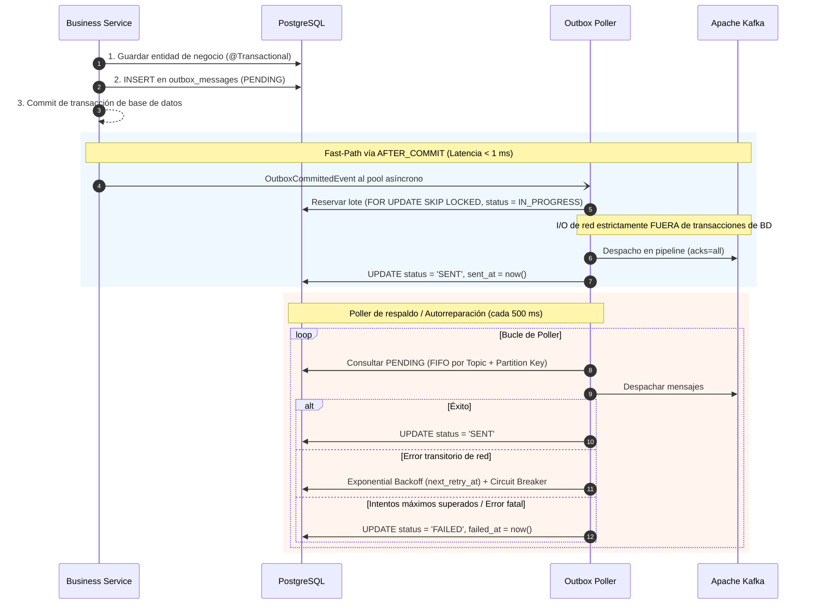
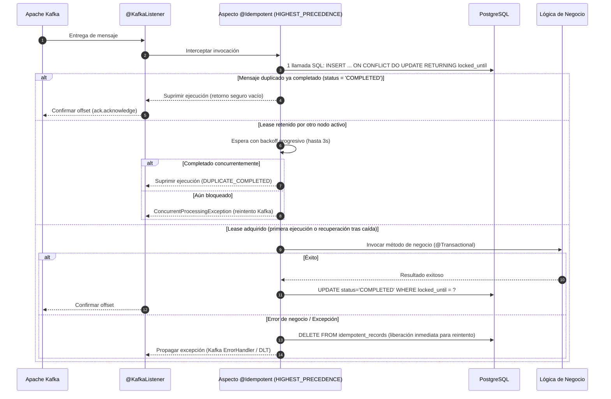

<div align="center">

# Idembox

**Transactional Outbox e Idempotent Consumer para Spring Boot 3 con PostgreSQL y Apache Kafka. Entrega At-Least-Once en el productor, procesamiento Exactly-Once en el consumidor. Sin infraestructura externa.**

<p align="center">
  <a href="../../LICENSE"></a>
  <a href="#requisitos"></a>
  <a href="#requisitos"></a>
  <a href="#requisitos"></a>
  <a href="#requisitos"></a>
  <a href="#pruebas"></a>
</p>

[English](../../README.md) ·
[Русский](README.ru.md) ·
[Deutsch](README.de.md) ·
**Español** ·
[中文](README.zh.md)

<p align="center">
  <a href="#características-principales">Características</a> •
  <a href="#cómo-funciona">Cómo funciona</a> •
  <a href="#requisitos">Requisitos</a> •
  <a href="#inicio-rápido-servicio-de-ejemplo">Inicio Rápido</a> •
  <a href="#integración-en-su-proyecto">Integración</a> •
  <a href="#configuración-applicationyml">Configuración</a> •
  <a href="#arquitectura-y-endurecimiento-para-producción">Arquitectura</a> •
  <a href="#monitoreo-y-métricas">Métricas</a>
</p>

</div>

---

**Idembox** resuelve los problemas clásicos de **Dual-Write** y **duplicación de mensajes** en microservicios distribuidos basados en Spring Boot.

Las entidades de negocio y los eventos de Outbox se confirman en una única transacción ACID en PostgreSQL (**patrón Transactional Outbox**), mientras que en el consumidor los mensajes entrantes se procesan exactamente una vez mediante el aspecto declarativo **`@Idempotent`**.

Sin clústeres de Debezium, sin Kafka Connect y sin dependencias externas pesadas. Funciona de forma nativa en su aplicación Spring Boot utilizando sus conexiones existentes a PostgreSQL y Kafka.

---

## Características principales

- **Elimina inconsistencias por Dual-Write** — Las entidades de negocio y los registros de Outbox se confirman atómicamente en PostgreSQL; si la transacción de negocio falla, ningún mensaje fantasma llega al broker.
- **Envío Fast-Path en menos de 1 ms** — El disparador `AFTER_COMMIT` envía a Kafka de inmediato de manera asíncrona sin esperar al intervalo del poller.
- **Garantía estricta de orden FIFO por Partition Key** — Nunca se despachan dos mensajes de la misma clave `(topic, partition_key)` en paralelo.
- **I/O de red aislado** — Publicación en Kafka fuera de las transacciones de BD mediante un `KafkaTemplate` no transaccional dedicado, protegiendo los pools HikariCP.
- **Despacho paralelo en pipeline** — Las claves independientes dentro de un lote se envían simultáneamente, alcanzando miles de eventos por segundo sin bloqueo Head-of-Line.
- **Arrendamiento en 1 round-trip SQL** — `@Idempotent` adquiere leases mediante `INSERT ... ON CONFLICT DO UPDATE ... RETURNING locked_until`.
- **Inmunidad a deadlocks en el pool** — Prioridad `Ordered.HIGHEST_PRECEDENCE`: el lease se adquiere y commitea en una transacción aislada `PROPAGATION_REQUIRES_NEW` liberando la conexión **antes** de abrir `@Transactional` ($1 \rightarrow 0 \rightarrow 1 \rightarrow 0$).
- **Recuperación tras caídas (Crash Recovery)** — Si un nodo se cae a mitad de procesamiento (OOM, SIGKILL), otro nodo asume el lease tras expirar `lockTimeout = 2m`.
- **Protección Split-Brain mediante Fencing Token** — La actualización a `COMPLETED` valida la fecha del lease (`WHERE locked_until = ?`), evitando que hilos demorados por pausas de GC sobreescriban bloqueos válidos.
- **Supresión segura de duplicados (`swallowDuplicate`)** — Retorna contenedores vacíos (`Optional.empty()`, listas vacías, completed futures) en lugar de lanzar `NullPointerException`.
- **Soporte para confirmación manual de offset** — Reconoce `AckMode.MANUAL` & `Message<?>` y confirma los offsets de Kafka automáticamente al suprimir duplicados.
- **Limpieza periódica sin interrupciones** — Tareas en segundo plano coordinadas mediante bloqueos consultivos de PostgreSQL (`LIMIT 5000 SKIP LOCKED`) para evitar Table Bloat.
- **Métricas completas para Micrometer y Prometheus** — Temporizadores de latencia, contadores de duplicados, gauges de retraso y alertas para Alertmanager.

---

## Cómo funciona

```
Business Service  →  @Transactional save  →  Tabla outbox_messages (PENDING)
                  →  AFTER_COMMIT trigger  →  Kafka Producer (acks=all)  [Fast-Path < 1 ms]
                  →  Fallback Poller (SKIP LOCKED)  →  Recuperación automática de fallos
                  →  @KafkaListener  →  @Idempotent (UPSERT lease)  →  Lógica de negocio (estrictamente 1x)
```

### Ciclo de vida de Transactional Outbox:


### Ciclo de vida de Idempotent Consumer:


---

## Requisitos

| Componente | Requisito |
|---|---|
| **Java** | 17 o superior |
| **Spring Boot** | 3.0.0 – 3.4.x |
| **PostgreSQL** | 13+ (con soporte para `jsonb`, `SKIP LOCKED`, `advisory locks`) |
| **Apache Kafka** | 3.0+ |
| **Herramientas de compilación** | Maven 3.8+ (o `./mvnw` incluido), Docker & Docker Compose |

---

## Inicio Rápido (Servicio de Ejemplo)

El repositorio incluye un microservicio de demostración listo para ejecutar [`samples/sample-order-service`](../../samples/sample-order-service/):

### Paso 1. Clonar el repositorio y entrar en el directorio:

```bash
git clone https://github.com/litvinov-alex/Idembox.git
cd Idembox/samples/sample-order-service
```

### Paso 2. Iniciar PostgreSQL y Kafka con Docker Compose:

```bash
docker-compose up -d
```

Verificar que ambos contenedores estén saludables:
```bash
docker-compose ps
```

### Paso 3. Ejecutar el microservicio de ejemplo:

```bash
# En Linux / macOS:
../../mvnw spring-boot:run

# En Windows (PowerShell):
..\..\mvnw.cmd spring-boot:run
```

### Paso 4. Verificar salud del servicio:

```bash
curl -s http://localhost:8080/actuator/health
```

Respuesta esperada: `{"status":"UP"}`

---

### Paso 5. Escenarios de prueba paso a paso:

#### 1. Crear un pedido y activar publicación en Outbox:
```bash
curl -i -X POST "http://localhost:8080/api/orders?customerId=cust-101&amount=450.00" \
  -H "Idempotency-Key: order-req-001"
```

#### 2. Inspeccionar estado en PostgreSQL:
```bash
docker exec -it sample-postgres psql -U postgres -d orders_db -c \
  "SELECT id, topic, status, retry_count, sent_at FROM outbox_messages;"
```

#### 3. Probar idempotencia enviando la misma solicitud duplicada:
```bash
curl -i -X POST "http://localhost:8080/api/orders?customerId=cust-101&amount=450.00" \
  -H "Idempotency-Key: order-req-001"
```

El pedido existente se devuelve de inmediato sin realizar cobros dobles ni generar mensajes Outbox duplicados.

---

## Integración en su proyecto

### 1. Añadir dependencia

#### Maven (`pom.xml`):
```xml
<dependency>
    <groupId>io.github.litvinov-alex</groupId>
    <artifactId>idembox-spring-boot-starter</artifactId>
    <version>0.1.0-SNAPSHOT</version>
</dependency>
```

#### Gradle (`build.gradle`):
```groovy
implementation 'io.github.litvinov-alex:idembox-spring-boot-starter:0.1.0-SNAPSHOT'
```

---

### 2. Aplicar migraciones de base de datos

El esquema [`schema-postgresql.sql`](../../idembox-spring-boot-starter/src/main/resources/db/migration/idembox/schema-postgresql.sql) incluye índices parciales optimizados.

#### Integración con Flyway (Recomendada):
```yaml
spring:
  flyway:
    locations:
      - classpath:db/migration
      - classpath:db/migration/idembox
```

---

### 3. Publicar eventos Outbox desde su servicio

```java
@Service
public class OrderService {

    private final OrderRepository orderRepository;
    private final OutboxPublisher outboxPublisher;

    public OrderService(OrderRepository orderRepository, OutboxPublisher outboxPublisher) {
        this.orderRepository = orderRepository;
        this.outboxPublisher = outboxPublisher;
    }

    @Transactional
    public Order createOrder(CreateOrderRequest request) {
        Order order = orderRepository.save(new Order(request.getCustomerId(), request.getAmount()));

        outboxPublisher.publish(
            "order-events",
            order.getId().toString(),
            new OrderCreatedEvent(order.getId(), order.getCustomerId(), order.getAmount()),
            Map.of("eventType", "OrderCreated", "source", "order-service")
        );

        return order;
    }
}
```

---

### 4. Asegurar el consumidor con `@Idempotent`

```java
@Service
public class PaymentConsumer {

    @KafkaListener(topics = "order-events", groupId = "payment-service-group")
    @Idempotent(
        key = "#event.orderId()",
        group = "payment-service-group",
        ttl = "7d",
        lockTimeout = "2m"
    )
    public void processPayment(@Payload OrderCreatedEvent event, Acknowledgment ack) {
        paymentGateway.charge(event.orderId(), event.amount());
        ack.acknowledge();
    }
}
```

---

## Configuración (`application.yml`)

Todos los parámetros se validan al iniciar la aplicación mediante JSR-380:

```yaml
idembox:
  initialize-schema: false         # Ejecutar DDL al iniciar (false en producción)
  table-schema: ""                 # Esquema de base de datos opcional
  table-prefix: ""                 # Prefijo de tablas opcional
  scheduler-pool-size: 4           # Tamaño del pool de hilos para poller y cleaners

  outbox:
    enabled: true                  # Habilitar productor y poller de Outbox
    poller:
      enabled: true                # Habilitar worker de lectura (false para pods solo de API)
      rate-ms: 500                 # Frecuencia de sondeo en milisegundos
    batch-size: 50                 # Tamaño de lote para FOR UPDATE SKIP LOCKED
    max-drain-batches: 10          # Lotes consecutivos máximos sin pausas
    immediate-flush: true          # Envío inmediato Fast-Path tras AFTER_COMMIT
    send-timeout: 10s              # Tiempo de espera para confirmación de Kafka
    max-payload-size: 1MB          # Límite protector para el tamaño del mensaje
    retention: 7d                  # Período de retención para mensajes SENT
    failed-retention: 30d          # Período de retención para mensajes FAILED
    max-retries: 5                 # Intentos máximos antes de marcar FAILED
    initial-backoff: 1s            # Pausa inicial de reintento
    max-backoff: 10m               # Backoff exponencial máximo
    backoff-multiplier: 2.0        # Multiplicador exponencial
    in-progress-lock-duration: 5m  # Duración del lease para mensajes IN_PROGRESS
    broker-cooldown: 10s           # Pausa de Circuit Breaker ante corte de red del broker
    preserve-creation-timestamp: false # true = enviar created_at a Kafka, false = hora del broker
    add-type-id-header: true       # Incluir cabecera __TypeId__ con el nombre de clase Java
    cleanup-cron: "0 0 * * * *"    # Cron para limpieza de mensajes enviados y fallidos
    cleaner:
      enabled: true
      batch-size: 5000             # Tamaño de lote para eliminaciones graduales
      max-batches-per-run: 100     # Lotes máximos por ejecución

  idempotency:
    enabled: true                  # Habilitar aspecto @Idempotent
    default-ttl: "7d"              # Ventana de retención para deduplicación
    default-lock-timeout: "2m"     # Timeout de lease in-flight para Crash Recovery
    in-flight-wait-timeout: 3s     # Espera máxima para ejecuciones concurrentes duplicadas
    fail-on-existing-transaction: true # Protección ante agotamiento del pool de conexiones
    fail-on-condition-error: true  # Lanzar error si la condición SpEL falla
    cleanup-cron: "0 0 * * * *"    # Cron para limpieza de registros expirados
    cleaner:
      enabled: true
      batch-size: 5000
      max-batches-per-run: 100

  metrics:
    enabled: true                  # Exportar métricas a Micrometer / Prometheus
```

---

## Arquitectura y endurecimiento para producción

### 1. Anomalía en el orden de commits en PostgreSQL (READ COMMITTED)
Bajo el nivel de aislamiento `READ COMMITTED`, dos transacciones simultáneas pueden completar su commit en un orden diferente al de inicio:
* La transacción A inicia en $T_1$, inserta el evento 1, pero se demora y confirma en $T_4$.
* La transacción B inicia en $T_2$, inserta el evento 2 y confirma rápidamente en $T_3$ ($T_3 < T_4$).
* Un poller que se ejecute entre $T_3$ y $T_4$ procesará el evento 2 antes que el evento 1.

> [!IMPORTANT]
> Para garantizar el orden FIFO absoluto en modificaciones simultáneas sobre una misma entidad, el código de negocio debe serializar los accesos mediante bloqueos pesimistas (`SELECT ... FOR UPDATE`).

### 2. Inmunidad a bloqueos mutuos en el pool de conexiones
El aspecto `@Idempotent` tiene prioridad `Ordered.HIGHEST_PRECEDENCE`. Adquiere y confirma el lease antes de abrir la transacción de negocio:
* Adquisición de lease: $1 \rightarrow 0$ conexiones activas.
* Lógica de negocio: $1 \rightarrow 0$ conexiones activas.
* Esto evita totalmente el bloqueo por agotamiento del pool de conexiones bajo cargas elevadas.

---

## Monitoreo y métricas

Las métricas se publican automáticamente bajo el prefijo `idembox.*`:

| Métrica | Tipo | Descripción | Etiquetas |
|---|---|---|---|
| `idembox.outbox.messages.enqueued` | Counter | Mensajes registrados en la tabla Outbox | `topic` |
| `idembox.outbox.messages.sent` | Counter | Mensajes entregados con éxito a Kafka | `topic` |
| `idembox.outbox.publish.latency` | Timer | Latencia de envío y acuse de recibo del broker | `topic` |
| `idembox.outbox.messages.failed` | Counter | Fallos transitorios de entrega al broker | `topic` |
| `idembox.outbox.messages.terminal.failures` | Counter | Fallos terminales (estado `FAILED` / Poison Pills) | `topic` |
| `idembox.outbox.messages.pending` | Gauge | Tamaño actual de la cola de Outbox | — |
| `idembox.outbox.leases.stolen` | Counter | Leases de poller recuperados de instancias caídas | `topic` |
| `idembox.idempotent.executions` | Counter | Ejecuciones del consumidor por resultado | `group`, `result` |
| `idembox.idempotent.lease_stolen` | Counter | Leases de consumidor recuperados tras fallos | `group` |

---

## Pruebas

El proyecto cuenta con **366 pruebas unitarias y de integración** exhaustivas ejecutadas sobre contenedores reales de PostgreSQL y Apache Kafka mediante Testcontainers:

```bash
# Ejecutar todas las pruebas:
./mvnw test
```

---

## Estructura del proyecto

| Módulo | Descripción |
|---|---|
| [`idembox-core`](../../idembox-core/) | Interfaces de dominio, modelos (`OutboxMessage`, `ProcessingState`), evaluador SpEL y anotación `@Idempotent`. Cero dependencias externas. |
| [`idembox-spring-boot-starter`](../../idembox-spring-boot-starter/) | Autoconfiguración Spring Boot 3, aspecto AOP, repositorios JDBC PostgreSQL, OutboxPoller y pruebas de integración. |
| [`samples/sample-order-service`](../../samples/sample-order-service/) | Microservicio de ejemplo con migraciones Flyway, API REST y `docker-compose.yml`. |

---

## Licencia

Este proyecto está licenciado bajo la **Licencia Apache 2.0**. Consulte [LICENSE](../../LICENSE) para más información.
