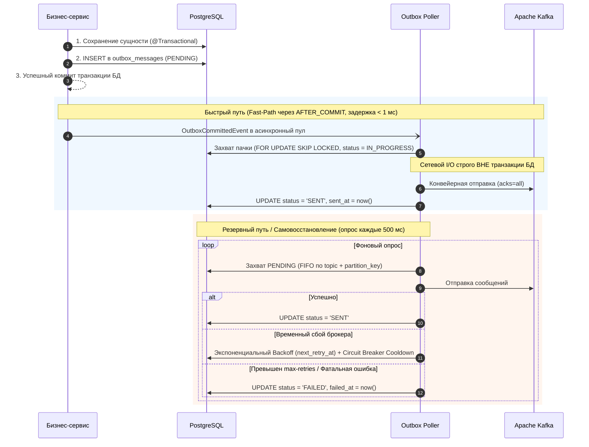
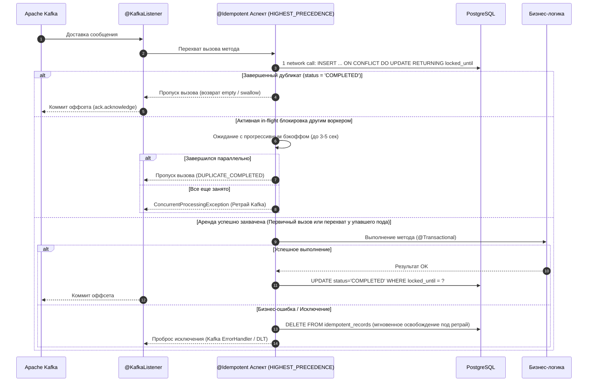

<div align="center">

# Idembox

**Надёжный Transactional Outbox и Idempotent Consumer для Spring Boot 3 поверх PostgreSQL и Apache Kafka. Гарантия At-Least-Once на стороне продюсера, Exactly-Once обработка на стороне консьюмера. Без внешней инфраструктуры.**

<p align="center">
  <a href="../../LICENSE"></a>
  <a href="#требования"></a>
  <a href="#требования"></a>
  <a href="#требования"></a>
  <a href="#требования"></a>
  <a href="#тесты"></a>
</p>

[English](../../README.md) ·
**Русский** ·
[Deutsch](README.de.md) ·
[Español](README.es.md) ·
[中文](README.zh.md)

<p align="center">
  <a href="#что-делает">Что делает</a> •
  <a href="#как-это-работает">Как это работает</a> •
  <a href="#требования">Требования</a> •
  <a href="#быстрый-запуск-демо-проекта">Быстрый запуск демо</a> •
  <a href="#подключение-в-свой-проект">Интеграция в свой проект</a> •
  <a href="#конфигурация-applicationyml">Конфигурация</a> •
  <a href="#архитектурные-гарантии-и-production-hardening">Архитектура и надёжность</a> •
  <a href="#мониторинг-и-метрики">Метрики</a>
</p>

</div>

---

**Idembox** решает классические проблемы **Dual-Write** и **дублирования сообщений** в распределённых микросервисных архитектурах на Spring Boot.

Сохранение бизнес-сущности в PostgreSQL и отправка события в Kafka объединяются в атомарную транзакцию БД через паттерн **Transactional Outbox**, а входящие события обрабатываются строго один раз через декларативный аспект **`@Idempotent`**.

Никаких отдельных серверов Debezium, кластеров Kafka Connect и тяжелых зависимостей. Всё работает нативно внутри вашего Spring Boot сервиса, использует существующие подключения к PostgreSQL и Kafka, обеспечивает субмиллисекундную доставку на горячем пути (**Fast-Path**) и устойчиво к любым сбоям сети и перезапускам подов.

---

<a id="что-делает"></a>
## Что делает

- **Устраняет Dual-Write рассинхронизацию** — бизнес-данные и события Outbox фиксируются в единой ACID-транзакции PostgreSQL; откат транзакции гарантирует, что фантомное событие не попадет в брокер.
- **Отправляет мгновенно по Fast-Path (< 1 мс)** — по триггеру `AFTER_COMMIT` сообщение немедленно передается в асинхронный пул и уходит в Kafka, не дожидаясь тика фонового поллера.
- **Гарантирует строгий FIFO-порядок** — для одного ключа партиционирования (`partition_key`) поллер никогда не отправляет два сообщения параллельно, исключая нарушение хронологии.
- **Изолирует сетевой ввод-вывод от транзакций БД** — сетевое взаимодействие с Kafka выполняется через выделенный не-транзакционный `KafkaTemplate` вне транзакций БД, защищая пул HikariCP от голодания.
- **Конвейеризует отправку (Pipelined Send)** — независимые ключи внутри одной пачки отправляются параллельно, обеспечивая пропускную способность в тысячи сообщений в секунду.
- **Дедуплицирует входящие сообщения за 1 round-trip** — аспект `@Idempotent` атомарно захватывает аренду ключа (`INSERT ... ON CONFLICT DO UPDATE ... RETURNING locked_until`) за ровно один сетевой запрос к PostgreSQL.
- **Защищает от дедлоков пула HikariCP** — аспект имеет приоритет `Ordered.HIGHEST_PRECEDENCE`: аренда фиксируется в короткой транзакции `PROPAGATION_REQUIRES_NEW`, которая коммитится и освобождает соединение **до** открытия бизнес-транзакции `@Transactional`.
- **Восстанавливает обработку упавших нод (Crash Recovery)** — разделение in-flight аренды (`lockTimeout = 2m`) и окна дедупликации (`ttl = 7d`): если под аварийно завершился (OOM, SIGKILL), соседняя нода безопасно перехватит задачу.
- **Защищает от Split-Brain через Fencing Token** — фиксация статуса `COMPLETED` выполняется строго по дедлайну выданной аренды (`WHERE locked_until = ?`), исключая перезапись чужой блокировки после длительной GC-паузы.
- **Безопасно подавляет дубликаты (`swallowDuplicate`)** — возвращает пустые контейнеры (`Optional.empty()`, `Collections.emptyList()`, completed future) вместо падений с NPE.
- **Поддерживает ручной коммит (`AckMode.MANUAL` и `Message<?>`)** — при отсечении дубликата автоматически извлекает `Acknowledgment` и подтверждает смещение в Kafka.
- **Автоматически убирает мусор без дедлоков** — фоновые клинеры с advisory locks PostgreSQL и чанками (`LIMIT 5000 SKIP LOCKED`) защищают таблицы от разрастания (Table Bloat).
- **Поставляет производственные метрики Micrometer** — таймеры сетевой задержки, счетчики дубликатов, лаг очереди Outbox и готовые Prometheus-алерты.

---

<a id="как-это-работает"></a>
## Как это работает

```
Бизнес-сервис  →  @Transactional save  →  Таблица outbox_messages (PENDING)
               →  Триггер AFTER_COMMIT  →  Kafka Producer (acks=all)  [Fast-Path < 1 мс]
               →  Fallback Poller (SKIP LOCKED)  →  Автоматическое самовосстановление
               →  @KafkaListener  →  @Idempotent (UPSERT lease)  →  Бизнес-логика (строго 1 раз)
```

### Жизненный цикл Transactional Outbox:


### Жизненный цикл Idempotent Consumer:


---

<a id="требования"></a>
## Требования

| Компонент       | Требование                                                         |
|-----------------|--------------------------------------------------------------------|
| **Java**        | 17 или новее                                                       |
| **Spring Boot** | 3.0.0 – 3.4.x                                                      |
| **PostgreSQL**  | 13+ (поддержка `jsonb`, `SKIP LOCKED`, `advisory locks`)           |
| **Apache Kafka**| 3.0+                                                               |
| **Сборка**      | Maven 3.8+ (или встроенный скрипт `./mvnw`), Docker & Docker Compose |

---

<a id="быстрый-запуск-демо-проекта"></a>
## Быстрый запуск демо-проекта

В репозиторий включен готовый демонстрационный микросервис [`samples/sample-order-service`](../../samples/sample-order-service), реализующий полный цикл: REST API $\rightarrow$ Transactional Outbox $\rightarrow$ Apache Kafka $\rightarrow$ Idempotent Consumer.

### Шаг 1. Клонирование и переход в каталог проекта

```bash
git clone https://github.com/litvinov-alex/Idembox.git
cd Idembox/samples/sample-order-service
```

### Шаг 2. Поднятие инфраструктуры через Docker Compose

Команда поднимает PostgreSQL 16 (порт 5432) и Apache Kafka 3.8 в KRaft-режиме (порт 9092) с настроенными healthcheck:

```bash
docker-compose up -d
```

Убедитесь, что контейнеры перешли в статус `healthy`:
```bash
docker-compose ps
```

### Шаг 3. Запуск демонстрационного приложения

Запустите сервис через Maven-обертку:

```bash
# На Linux / macOS:
../../mvnw spring-boot:run

# На Windows (PowerShell):
..\..\mvnw.cmd spring-boot:run
```

При старте сервис:
1. Автоматически накатит схему таблиц заказов и Idembox через Flyway.
2. Подключится к Kafka и поднимет консьюмер топика `order-events`.
3. Запустит фоновый поллер Outbox и шедулеры очистки.

### Шаг 4. Проверка работоспособности

В отдельном терминале выполните проверку статуса через Spring Boot Actuator:

```bash
curl -s http://localhost:8080/actuator/health
```

Ожидаемый ответ:
```json
{"status":"UP"}
```

---

### Шаг 5. Пошаговое тестирование сценариев

#### 1. Создание заказа и отправка события в Outbox
Отправьте запрос на создание заказа с уникальным ключом идемпотентности:

```bash
curl -i -X POST "http://localhost:8080/api/orders?customerId=cust-101&amount=450.00" \
  -H "Idempotency-Key: order-req-001"
```

Ответ сервиса:
```http
HTTP/1.1 200 OK
Content-Type: application/json

{
  "orderId": "ORD-6f1c4e20-7b3a-4a61-9c42-88d3e91b5a2b",
  "message": "Order persisted and transactional Outbox event published to Kafka!",
  "status": "CREATED"
}
```

Что произошло под капотом:
1. В единой транзакции БД сохранен заказ в таблицу `orders` и сформирована запись в `outbox_messages` со статусом `PENDING`.
2. После коммита триггер `AFTER_COMMIT` мгновенно отправил событие в Kafka.
3. Поллер обновил статус в `outbox_messages` на `SENT`.
4. `@KafkaListener` принял событие, `@Idempotent` захватил аренду ключа, выполнил обработку и зафиксировал статус `COMPLETED` в `idempotent_records`.

#### 2. Проверка состояния в базе данных PostgreSQL

```bash
docker exec -it sample-postgres psql -U postgres -d orders_db -c \
  "SELECT id, topic, status, retry_count, sent_at FROM outbox_messages;"
```

Вывод:
```text
                  id                  |    topic     | status | retry_count |            sent_at            
--------------------------------------+--------------+--------+-------------+-------------------------------
 01926b48-1234-7abc-8def-0123456789ab | order-events | SENT   |           0 | 2026-10-14 15:30:00.123456+00
(1 row)
```

Проверка записи дедупликации:
```bash
docker exec -it sample-postgres psql -U postgres -d orders_db -c \
  "SELECT consumer_group, event_key, status, completed_at FROM idempotent_records;"
```

Вывод:
```text
     consumer_group    |              event_key               |  status   |         completed_at          
-----------------------+--------------------------------------+-----------+-------------------------------
 payment-service-group | ORD-6f1c4e20-7b3a-4a61-9c42-88d3e91b | COMPLETED | 2026-10-14 15:30:00.245123+00
(1 row)
```

#### 3. Тестирование защиты от повторных HTTP-запросов (Ingress Deduplication)
Повторите в точности тот же запрос с заголовком `Idempotency-Key: order-req-001`:

```bash
curl -i -X POST "http://localhost:8080/api/orders?customerId=cust-101&amount=450.00" \
  -H "Idempotency-Key: order-req-001"
```

Ответ:
```http
HTTP/1.1 200 OK
Content-Type: application/json

{
  "orderId": "ORD-6f1c4e20-7b3a-4a61-9c42-88d3e91b5a2b",
  "message": "Order already exists, duplicate ignored",
  "status": "EXISTS"
}
```
*Результат:* Новый заказ **не создавался**, повторное событие в Outbox **не публиковалось**, клиент получил идентификатор существующего заказа.

#### 4. Тестирование дедупликации на стороне Kafka Consumer (`@Idempotent`)
В логах приложения вы увидите штатную фиксацию первичного события:
```text
INFO  [payment-service-group-0-C-1] i.g.a.s.c.PaymentOrderConsumer : Successfully charged payment for order ORD-6f1c4e20... amount: 450.00
```
Если отправить дубликат сообщения напрямую в топик Kafka или сымитировать redelivery брокера, аспект `@Idempotent` перехватит дубликат за 1 SQL-запрос, вернет управление без запуска бизнес-логики и подтвердит оффсет в Kafka.

#### 5. Просмотр метрик в Prometheus
Проверьте счетчики и таймеры Idembox через Actuator:

```bash
curl -s http://localhost:8080/actuator/prometheus | grep idembox
```

Пример вывода:
```text
idembox_outbox_messages_enqueued_total{topic="order-events"} 1.0
idembox_outbox_messages_sent_total{topic="order-events"} 1.0
idembox_outbox_publish_latency_seconds_count{topic="order-events"} 1.0
idembox_outbox_messages_pending 0.0
idembox_idempotent_executions_total{group="payment-service-group",result="acquired"} 1.0
```

### Шаг 6. Остановка демонстрационного стенда

```bash
# Остановка приложения: Ctrl+C в окне терминала

# Остановка и очистка Docker-контейнеров и томов:
docker-compose down -v
```

---

<a id="подключение-в-свой-проект"></a>
## Подключение в свой проект

### 1. Подключение зависимости

#### Maven (`pom.xml`):
```xml
<dependency>
    <groupId>io.github.litvinov-alex</groupId>
    <artifactId>idembox-spring-boot-starter</artifactId>
    <version>0.1.0</version>
</dependency>
```

#### Gradle (`build.gradle`):
```groovy
implementation 'io.github.litvinov-alex:idembox-spring-boot-starter:0.1.0'
```

---

### 2. Применение схемы базы данных

Стартер предоставляет готовый DDL со всеми необходимыми частичными индексами: [`schema-postgresql.sql`](../../idembox-spring-boot-starter/src/main/resources/db/migration/idembox/schema-postgresql.sql).

#### Вариант А: Подключение через Flyway (Рекомендуется)
Укажите расположение схемы стартера в `application.yml`:
```yaml
spring:
  flyway:
    locations:
      - classpath:db/migration            # Ваши бизнес-миграции
      - classpath:db/migration/idembox  # Схема Idembox
```
*Или* скопируйте SQL-скрипт в каталог миграций вашего сервиса под именем `V2__init_idembox.sql`.

#### Вариант Б: Подключение через Liquibase
Включите файл в корневой чейнджлог `db.changelog-master.yaml`:
```yaml
databaseChangeLog:
  - include:
      file: db/migration/idembox/schema-postgresql.sql
```

---

### 3. Публикация событий (Transactional Outbox)

Внедрите бин `OutboxPublisher` в ваш бизнес-сервис. Публикуйте события строго внутри метода, помеченного `@Transactional`:

```java
@Service
public class OrderService {

    private final OrderRepository orderRepository;
    private final OutboxPublisher outboxPublisher;

    public OrderService(OrderRepository orderRepository, OutboxPublisher outboxPublisher) {
        this.orderRepository = orderRepository;
        this.outboxPublisher = outboxPublisher;
    }

    @Transactional
    public Order createOrder(CreateOrderCommand cmd) {
        // 1. Изменение состояния доменной модели в PostgreSQL
        Order order = orderRepository.save(new Order(cmd));

        // 2. Атомарная публикация события в Outbox
        outboxPublisher.publish(
            "order-events",                  // Топик Kafka
            order.getId().toString(),         // Ключ партиционирования Kafka (FIFO)
            new OrderCreatedEvent(order.getId(), order.getCustomerId(), order.getAmount())
        );

        return order;
    }
}
```

---

### 4. Идемпотентная обработка (Idempotent Consumer)

Пометьте метод слушателя Kafka аннотацией `@Idempotent`:

```java
@Component
public class PaymentOrderConsumer {

    private final PaymentProcessor paymentProcessor;

    public PaymentOrderConsumer(PaymentProcessor paymentProcessor) {
        this.paymentProcessor = paymentProcessor;
    }

    @KafkaListener(topics = "order-events", groupId = "payment-service-group")
    @Idempotent(
        key = "#root.args[0].orderId",       // SpEL-выражение для извлечения бизнес-ключа
        consumerGroup = "payment-service",   // Имя группы (по умолчанию генерируется из Class#method)
        ttl = "7d",                          // Окно защиты от дубликатов (7 дней)
        lockTimeout = "2m",                  // Аренда воркера (2 минуты)
        swallowDuplicate = true              // Подавлять дубликаты без исключения
    )
    public void onOrderCreated(OrderCreatedEvent event, Acknowledgment ack) {
        // Гарантированно выполнится строго 1 раз для каждого orderId
        paymentProcessor.charge(event.orderId(), event.amount());
        ack.acknowledge();
    }
}
```

---

<a id="конфигурация-applicationyml"></a>
## Конфигурация (`application.yml`)

Все параметры валидируются при старте приложения (JSR-380 / Hibernate Validator):

```yaml
idembox:
  # Инициализация схемы стартером (false в проде, используйте Flyway/Liquibase)
  initialize-schema: false
  # Опциональная схема БД или префикс таблиц (например, table-schema: my_schema)
  table-schema: ""
  table-prefix: ""
  # Размер пула потоков внутреннего планировщика задач
  scheduler-pool-size: 4

  outbox:
    enabled: true                  # Включение продюсера и фоновых компонентов Outbox
    poller:
      enabled: true                # Фоновый опрос БД (выставляйте false для чистых Web API реплик)
      rate-ms: 500                 # Частота опроса БД фоновым воркером (мс)
    batch-size: 50                 # Размер пачки строк для выборки через SKIP LOCKED
    max-drain-batches: 10          # Максимум пачек подряд без пауз при выкачивании накопившейся очереди
    immediate-flush: true          # Мгновенная отправка по событию AFTER_COMMIT (Fast-Path)
    send-timeout: 10s              # Таймаут подтверждения сетевой отправки брокером Kafka
    max-payload-size: 1MB          # Защитный лимит размера сообщения (защита TOAST в Postgres и JVM RAM)
    retention: 7d                  # Срок хранения отправленных сообщений (SENT) до очистки
    failed-retention: 30d          # Срок хранения окончательно сбойных сообщений (FAILED) для анализа
    max-retries: 5                 # Число повторных попыток отправки до перевода в статус FAILED
    initial-backoff: 1s            # Начальная пауза перед повторной попыткой
    max-backoff: 10m               # Предельный интервал экспоненциального бэкоффа
    backoff-multiplier: 2.0        # Множитель экспоненты
    in-progress-lock-duration: 5m  # Таймаут аренды IN_PROGRESS до возврата в очередь при аварии ноды
    broker-cooldown: 10s           # Защитная пауза при сетевом сбое брокера (Circuit Breaker)
    preserve-creation-timestamp: false # true = отправлять в Kafka created_at, false = текущее время брокера
    add-type-id-header: true       # Автоматически добавлять заголовок __TypeId__ с именем Java-класса
    cleanup-cron: "0 0 * * * *"    # Расписание очистки отправленных и сбойных сообщений (ежечасно)
    cleaner:
      enabled: true
      batch-size: 5000             # Размер чанка при удалении (порционный DELETE для разгрузки VACUUM)
      max-batches-per-run: 100     # Лимит чанков за один запуск очистки

  idempotency:
    enabled: true                  # Включение AOP-аспекта @Idempotent
    default-ttl: "7d"              # Срок защиты от повторов (форматы: 7d, 24h, 30m, ISO-8601)
    default-lock-timeout: "2m"     # Таймаут аренды in-flight обработки для перехвата упавших воркеров
    in-flight-wait-timeout: 3s     # Ожидание завершения параллельно исполняемого дубликата
    fail-on-existing-transaction: true # Защита от дедлока пула при вызове внутри внешней @Transactional
    fail-on-condition-error: true  # Выбрасывать ошибку при падении SpEL выражения в условии
    cleanup-cron: "0 0 * * * *"    # Расписание очистки устаревших записей дедупликации
    cleaner:
      enabled: true
      batch-size: 5000
      max-batches-per-run: 100

  metrics:
    enabled: true                  # Экспорт метрик в Micrometer / Prometheus
```

---

<a id="архитектурные-гарантии-и-production-hardening"></a>
## Архитектурные гарантии и Production Hardening

### 1. Аномалия порядка коммитов (Commit Order Anomaly в PostgreSQL)
При стандартном уровне изоляции `READ COMMITTED` две параллельные транзакции по одной и той же сущности могут завершиться в ином порядке, чем начались:
* Транзакция А стартует в $T_1$, вставляет событие 1 (`created_at = T_1`), но коммитится долго до $T_4$.
* Транзакция Б стартует в $T_2$, вставляет событие 2 (`created_at = T_2`) и быстро коммитится в $T_3$ ($T_3 < T_4$).
* Фоновый поллер в момент между $T_3$ и $T_4$ вычитает событие 2 и отправит его в Kafka раньше события 1.

> [!IMPORTANT]
> **Инженерное правило для гарантии строгого FIFO-порядка:**
> Это фундаментальное свойство СУБД с MVCC. Если для вашего бизнес-домена критичен строгий хронологический порядок событий одного агрегата, **бизнес-код обязан сериализовать изменения сущности с помощью пессимистической блокировки**:
> ```java
> Order order = orderRepository.findByIdForUpdate(orderId); // SELECT ... FOR UPDATE
> ```
> Это гарантирует, что порядок фиксации транзакций строго совпадет с хронологией событий.

---

### 2. Защита пула HikariCP от дедлоков (Connection Pool Deadlock Guard)
* **Последовательный захват соединений:** Благодаря приоритету `Ordered.HIGHEST_PRECEDENCE` аспект `@Idempotent` выполняет захват аренды в короткой изолированной транзакции `PROPAGATION_REQUIRES_NEW`, фиксирует её и **возвращает соединение в пул HikariCP ДО** входа в `@Transactional`. Соединения запрашиваются строго последовательно ($1 \rightarrow 0 \rightarrow 1 \rightarrow 0$), исключая одновременное удержание двух коннектов одним потоком.
* **Изолированный пул соединений:** При экстремальных нагрузках инфраструктурный трафик библиотеки можно вынести в отдельный пул. Стартер автоматически привяжется к выделенному пулу, если объявить бин с именем `idemboxDataSource` или `idemboxJdbcTemplate`:
  ```java
  @Bean
  @Qualifier("idemboxDataSource")
  public DataSource idemboxDataSource() {
      HikariConfig config = new HikariConfig();
      config.setJdbcUrl("jdbc:postgresql://localhost:5432/orders_db");
      config.setMaximumPoolSize(10); // Выделенный пул на 5-10 соединений
      return new HikariDataSource(config);
  }
  ```

---

### 3. Возвращаемые значения при дедупликации (`swallowDuplicate`)
Если метод с `@Idempotent` возвращает результат (не `void`) и срабатывает отсечение дубликата (`swallowDuplicate = true`):
* `Optional<T>` $\rightarrow$ возвращается `Optional.empty()`.
* Коллекции (`List`, `Set`, `Map`) $\rightarrow$ возвращаются неизменяемые пустые коллекции (`emptyList()`, `emptySet()`, `emptyMap()`).
* `CompletableFuture<T>` $\rightarrow$ возвращается `completedFuture(null)`.
* Примитивы $\rightarrow$ возвращаются дефолтные значения (`0`, `false`).
* Пользовательские объекты (например, `PaymentResult`) $\rightarrow$ возвращается `null`.

> [!TIP]
> Если вызывающий код в том же потоке ожидает непустой объект, возвращайте `Optional<MyResult>` либо укажите `swallowDuplicate = false` (будет выброшено исключение `DuplicateMessageException`, которое перехватывается вашим обработчиком ошибок).

---

### 4. Ограничение: Single-Record Consumer
Аннотация `@Idempotent` строго рассчитана на поштучную обработку сообщений (`ConsumerRecord`, POJO, `Message<?>`).
Попытка аннотировать метод, принимающий пакет (`List<ConsumerRecord>` или `Collection<T>`), будет пресечена на этапе старта приложения компонентом `IdempotentStartupValidator` с исключением `BeanInitializationException`. Для пакетных слушателей дедупликацию следует выполнять программно внутри цикла через `IdempotentRepository.tryAcquire(...)`.

---

### 5. Тюнинг Kafka Producer для сохранения порядка в партиции
OutboxPoller отправляет сообщения пачки асинхронно для достижения высокой пропускной способности. Чтобы сетевые повторы Kafka Producer не нарушили порядок внутри партиции:
* В Apache Kafka 3.x+ идемпотентность продюсера включена по умолчанию (`enable.idempotence = true`).
* Убедитесь, что конфигурация продюсера в вашем сервисе содержит:
  ```yaml
  spring:
    kafka:
      producer:
        acks: all
        properties:
          enable.idempotence: true
          max.in.flight.requests.per.connection: 5 # Допустимо до 5 при включенной идемпотентности
  ```

---

### 6. Нагрузка на PostgreSQL и Autovacuum (High-Load 5000+ msg/s)
Жизненный цикл очередей (`INSERT` $\rightarrow$ `UPDATE` $\rightarrow$ `DELETE`) в MVCC-архитектуре PostgreSQL генерирует мертвые строки (dead tuples). Чтобы предотвратить разрастание таблиц (Table Bloat), примените настройки из файла [`dba-tuning-postgresql.sql`](../../idembox-spring-boot-starter/src/main/resources/db/migration/idembox/dba-tuning-postgresql.sql):

```sql
ALTER TABLE outbox_messages SET (
    autovacuum_vacuum_scale_factor = 0.05,
    autovacuum_vacuum_cost_limit = 1000
);

ALTER TABLE idempotent_records SET (
    autovacuum_vacuum_scale_factor = 0.05,
    autovacuum_vacuum_cost_limit = 1000
);
```

> [!NOTE]
> **Пределы масштабирования:**
> Табличный Outbox на PostgreSQL обеспечивает стабильную работу при потоке до **5 000 – 7 000 сообщений в секунду** на стандартном сервере БД. При постоянной нагрузке свыше **10 000 msg/s** рекомендуется рассмотреть переход на Debezium CDC (чтение WAL-лога PostgreSQL).

---

<a id="мониторинг-и-метрики"></a>
## Мониторинг и метрики

Стартер автоматически регистрирует производственные метрики в `MeterRegistry` (Micrometer / Prometheus):

| Метрика                                    | Тип     | Описание                                                | Теги                                                               |
|--------------------------------------------|---------|---------------------------------------------------------|--------------------------------------------------------------------|
| `idembox.outbox.messages.enqueued`         | Counter | Количество событий, записанных в таблицу Outbox         | `topic`                                                            |
| `idembox.outbox.messages.sent`             | Counter | Успешно отправленные сообщения в Kafka                  | `topic`                                                            |
| `idembox.outbox.publish.latency`           | Timer   | Время сетевой отправки и подтверждения брокером Kafka   | `topic`                                                            |
| `idembox.outbox.messages.failed`           | Counter | Транзиентные ошибки отправки в брокер                   | `topic`                                                            |
| `idembox.outbox.messages.terminal.failures`| Counter | Терминальные сбои (перевод в `FAILED` / Poison Pills)   | `topic`                                                            |
| `idembox.outbox.messages.pending`          | Gauge   | Текущий размер очереди необработанных сообщений в Outbox| —                                                                  |
| `idembox.outbox.leases.stolen`             | Counter | Перехваты устаревших аренд упавших инстансов поллера    | `topic`                                                            |
| `idembox.idempotent.executions`            | Counter | Исполнения идемпотентного консьюмера по результатам     | `group`, `result` (`acquired`, `duplicate`, `failed`, `concurrent_retry`) |
| `idembox.idempotent.lease_stolen`          | Counter | Перехваты аренды консьюмера у упавшего пода             | `group`                                                            |

### Готовые PromQL-алерты для Prometheus Alertmanager:

```yaml
# 1. Рост очереди Outbox (задержка доставки)
- alert: OutboxQueueBacklogHigh
  expr: idembox_outbox_messages_pending > 1000
  for: 3m
  labels:
    severity: warning
  annotations:
    summary: "Outbox backlog is growing on {{ $labels.instance }}"

# 2. Появление Poison Pills / Терминальных ошибок
- alert: OutboxTerminalFailuresDetected
  expr: rate(idembox_outbox_messages_terminal_failures_total[5m]) > 0
  for: 1m
  labels:
    severity: critical
  annotations:
    summary: "Outbox messages are permanently failing (Poison Pills)"

# 3. Высокая задержка отправки в Kafka (p99 > 2s)
- alert: OutboxPublishLatencyHigh
  expr: histogram_quantile(0.99, sum(rate(idembox_outbox_publish_latency_seconds_bucket[5m])) by (le, topic)) > 2
  for: 2m
  labels:
    severity: warning
  annotations:
    summary: "Kafka publish latency p99 exceeds 2s for topic {{ $labels.topic }}"
```

---

<a id="тесты"></a>
## Тесты

Проект содержит всеобъемлющий набор из **366 юнит- и интеграционных тестов**, проверяющих поведение системы при сетевых сбоях, ребалансировках и авариях подов с использованием реальных контейнеров PostgreSQL и Apache Kafka (Testcontainers):

```bash
# Запуск полного набора тестов:
./mvnw test
```

---

<a id="структура-проекта"></a>
## Структура проекта

| Модуль                                                            | Описание                                                                                                                              |
|-------------------------------------------------------------------|---------------------------------------------------------------------------------------------------------------------------------------|
| [`idembox-core`](../../idembox-core)                              | Чистые интерфейсы, модели (`OutboxMessage`, `ProcessingState`), SpEL парсер ключей и аннотация `@Idempotent`. Ноль сторонних зависимостей. |
| [`idembox-spring-boot-starter`](../../idembox-spring-boot-starter) | Автоконфигурация Spring Boot 3, AOP-аспект, высокопроизводительные JDBC-репозитории PostgreSQL, OutboxPoller и интеграционные тесты Testcontainers. |
| [`samples/sample-order-service`](../../samples/sample-order-service) | Демонстрационный микросервис с Flyway-миграциями, REST API и `docker-compose.yml`.                                                |

---

<a id="лицензия"></a>
## Лицензия

Проект распространяется под лицензией **Apache 2.0**. Полный текст лицензии доступен в файле [LICENSE](../../LICENSE).
