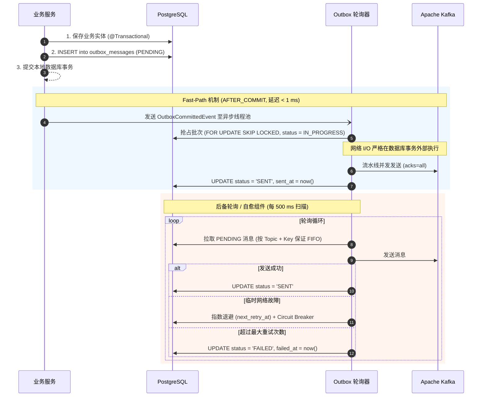
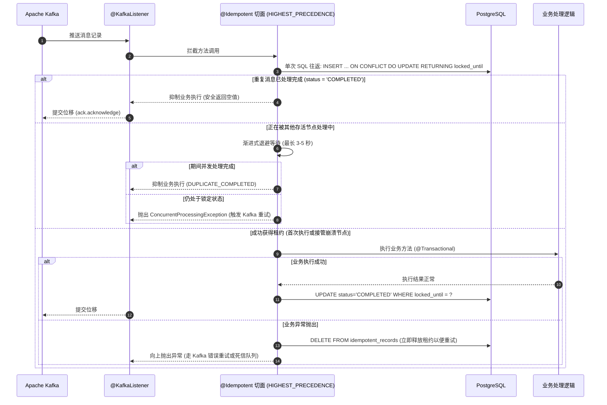

<div align="center">

# Idembox

**基于 PostgreSQL 与 Apache Kafka 的 Spring Boot 3 高可靠事务型 Outbox 与幂等消费组件。生产者 At-Least-Once 保障，消费者 Exactly-Once 语义。无需外部基础设施。**

<p align="center">
  <a href="../../LICENSE"></a>
  <a href="#运行要求"></a>
  <a href="#运行要求"></a>
  <a href="#运行要求"></a>
  <a href="#运行要求"></a>
  <a href="#测试"></a>
</p>

[English](../../README.md) ·
[Русский](README.ru.md) ·
[Deutsch](README.de.md) ·
[Español](README.es.md) ·
**中文**

<p align="center">
  <a href="#核心特性">核心特性</a> •
  <a href="#工作原理">工作原理</a> •
  <a href="#运行要求">运行要求</a> •
  <a href="#快速启动示例项目">快速启动</a> •
  <a href="#集成至您的项目">集成指南</a> •
  <a href="#配置说明-applicationyml">配置说明</a> •
  <a href="#生产级架构与高可用设计">架构设计</a> •
  <a href="#监控与度量指标">监控指标</a>
</p>

</div>

---

**Idembox** 旨在彻底解决分布式 Spring Boot 微服务架构中的 **Dual-Write（双写不一致）** 和 **消息重复消费** 问题。

业务数据入库与 Kafka 消息发送在同一个 PostgreSQL 本地 ACID 事务中完成（**Transactional Outbox** 模式），而在消费端通过声明式的 **`@Idempotent`** 切面保证业务逻辑严格仅执行一次。

无需部署 Debezium 集群、无需 Kafka Connect，也没有多余的第三方框架依赖。完全基于现有的 PostgreSQL 与 Kafka 运行，在快路径（**Fast-Path**）下实现亚毫秒级低延迟投递，具备高容错性与崩溃自愈能力。

---

## 核心特性

- **消除 Dual-Write 风险** — 业务持久化与 Outbox 记录在 PostgreSQL 同一事务内提交；事务回滚确保绝无幻象消息流出到 Kafka。
- **Fast-Path 亚毫秒级即时投递 (< 1ms)** — 事务提交时通过 `AFTER_COMMIT` 钩子异步分发至线程池，无需等待轮询间隔即可直接发送至 Kafka。
- **严格保障单个 Partition Key 的 FIFO 顺序** — 针对同一个 `(topic, partition_key)`，轮询器绝不同时并发拉取或发送两条消息，确保消息顺序性。
- **网络 I/O 隔离** — 使用专用的非事务性 `KafkaTemplate` 在数据库事务外部执行网络调用，彻底消除 HikariCP 连接池耗尽风险。
- **并行流水线发送（Pipeline Dispatch）** — 批次内独立键的消息并发推送，在无 Head-of-Line 阻塞的情况下支持每秒数千条消息的吞吐。
- **单次 SQL 往返租约抢占** — `@Idempotent` 切面使用 `INSERT ... ON CONFLICT DO UPDATE ... RETURNING locked_until` 在单次数据库网络往返内完成租约获取。
- **连接池死锁免疫** — 切面优先级设为 `Ordered.HIGHEST_PRECEDENCE`，租约获取在隔离的 `PROPAGATION_REQUIRES_NEW` 事务中立即提交并归还连接，随后才开启业务 `@Transactional` 事务（$1 \rightarrow 0 \rightarrow 1 \rightarrow 0$）。
- **崩溃自动恢复（Crash Recovery）** — 区分运行时租约（`lockTimeout = 2m`）与业务去重窗口（`ttl = 7d`）。若实例因 OOM 或 SIGKILL 异常崩溃，其他节点在租约过期后自动接管。
- **防脑裂 Fencing Token** — 状态更新严格校验租约截止时间（`WHERE locked_until = ?`），防止 GC 长停顿后的迟到工作线程覆盖新节点的锁。
- **安全抑制重复（`swallowDuplicate`）** — 对于容器类型返回 `Optional.empty()`、空集合或已完成的 Future，避免空指针异常。
- **支持手动确认 Offset** — 适配 `AckMode.MANUAL` 与 `Message<?>`，在抑制重复时自动触发 Kafka Offset 提交。
- **无死锁批量清理** — 后台清理任务通过 PostgreSQL Advisory Lock 进行分布式协同，分批次删除历史过期记录（`LIMIT 5000 SKIP LOCKED`），防止 Table Bloat。
- **开箱即用的 Micrometer / Prometheus 指标** — 发送延迟 Timer、重复消息计数器、Outbox 积压 Gauge 以及生产级 Alertmanager 告警规则。

---

## 工作原理

```
业务服务  →  @Transactional 持久化  →  表 outbox_messages (PENDING)
          →  AFTER_COMMIT 触发器  →  Kafka 生产者 (acks=all)  [Fast-Path < 1 ms]
          →  后备轮询器 (SKIP LOCKED)  →  自动故障自愈与重试
          →  @KafkaListener  →  @Idempotent (UPSERT 租约)  →  业务逻辑 (严格执行 1 次)
```

### Transactional Outbox 生命周期：


### Idempotent Consumer 幂等消费生命周期：


---

## 运行要求

| 组件 | 版本要求 |
|---|---|
| **Java** | 17 或更高版本 |
| **Spring Boot** | 3.0.0 – 3.4.x |
| **PostgreSQL** | 13+ (支持 `jsonb`、`SKIP LOCKED`、`advisory locks`) |
| **Apache Kafka** | 3.0+ |
| **构建工具** | Maven 3.8+ (或自带 `./mvnw`)、Docker & Docker Compose |

---

## 快速启动示例项目

仓库包含完整的演示微服务 [`samples/sample-order-service`](../../samples/sample-order-service/)：

### 步骤 1. 克隆仓库并进入示例目录：

```bash
git clone https://github.com/litvinov-alex/Idembox.git
cd Idembox/samples/sample-order-service
```

### 步骤 2. 启动基础组件：

```bash
docker-compose up -d
```

确认容器健康检查状态正常：
```bash
docker-compose ps
```

### 步骤 3. 运行微服务：

```bash
# 在 Linux / macOS 上:
../../mvnw spring-boot:run

# 在 Windows (PowerShell) 上:
..\..\mvnw.cmd spring-boot:run
```

### 步骤 4. 验证服务健康检查：

```bash
curl -s http://localhost:8080/actuator/health
```

预期输出: `{"status":"UP"}`

---

### 步骤 5. 测试核心流程场景：

#### 1. 创建订单并触发 Outbox 发布：
```bash
curl -i -X POST "http://localhost:8080/api/orders?customerId=cust-101&amount=450.00" \
  -H "Idempotency-Key: order-req-001"
```

#### 2. 查看数据库中 Outbox 表的状态：
```bash
docker exec -it sample-postgres psql -U postgres -d orders_db -c \
  "SELECT id, topic, status, retry_count, sent_at FROM outbox_messages;"
```

#### 3. 验证幂等消费防护（重复请求）：
```bash
curl -i -X POST "http://localhost:8080/api/orders?customerId=cust-101&amount=450.00" \
  -H "Idempotency-Key: order-req-001"
```

由于幂等键已被消费并记录，第二次请求直接返回已有订单结果，绝不会产生二次扣款或重复 Outbox 事件。

---

## 集成至您的项目

### 1. 引入 Maven / Gradle 依赖

#### Maven (`pom.xml`):
```xml
<dependency>
    <groupId>io.github.litvinov-alex</groupId>
    <artifactId>idembox-spring-boot-starter</artifactId>
    <version>0.1.0-SNAPSHOT</version>
</dependency>
```

#### Gradle (`build.gradle`):
```groovy
implementation 'io.github.litvinov-alex:idembox-spring-boot-starter:0.1.0-SNAPSHOT'
```

---

### 2. 执行数据库迁移

初始化脚本包含高性能覆盖部分索引：[`schema-postgresql.sql`](../../idembox-spring-boot-starter/src/main/resources/db/migration/idembox/schema-postgresql.sql)。

#### Flyway 集成配置（推荐）：
```yaml
spring:
  flyway:
    locations:
      - classpath:db/migration
      - classpath:db/migration/idembox
```

---

### 3. 在业务服务中发布 Outbox 消息

```java
@Service
public class OrderService {

    private final OrderRepository orderRepository;
    private final OutboxPublisher outboxPublisher;

    public OrderService(OrderRepository orderRepository, OutboxPublisher outboxPublisher) {
        this.orderRepository = orderRepository;
        this.outboxPublisher = outboxPublisher;
    }

    @Transactional
    public Order createOrder(CreateOrderRequest request) {
        Order order = orderRepository.save(new Order(request.getCustomerId(), request.getAmount()));

        outboxPublisher.publish(
            "order-events",
            order.getId().toString(),
            new OrderCreatedEvent(order.getId(), order.getCustomerId(), order.getAmount()),
            Map.of("eventType", "OrderCreated", "source", "order-service")
        );

        return order;
    }
}
```

---

### 4. 使用 `@Idempotent` 守护消费者

```java
@Service
public class PaymentConsumer {

    @KafkaListener(topics = "order-events", groupId = "payment-service-group")
    @Idempotent(
        key = "#event.orderId()",
        group = "payment-service-group",
        ttl = "7d",
        lockTimeout = "2m"
    )
    public void processPayment(@Payload OrderCreatedEvent event, Acknowledgment ack) {
        paymentGateway.charge(event.orderId(), event.amount());
        ack.acknowledge();
    }
}
```

---

## 配置说明 (`application.yml`)

所有参数在启动时均通过 JSR-380 进行严格校验：

```yaml
idembox:
  initialize-schema: false         # 启动时是否自动运行 DDL (生产环境请设为 false)
  table-schema: ""                 # 可选自定义数据库模式 (schema)
  table-prefix: ""                 # 可选表名前缀
  scheduler-pool-size: 4           # 轮询与清理任务调度线程池大小

  outbox:
    enabled: true                  # 是否启用 Outbox 发布器与轮询器
    poller:
      enabled: true                # 是否启用后台轮询工作线程 (纯 API 节点可设为 false)
      rate-ms: 500                 # 数据库轮询周期 (毫秒)
    batch-size: 50                 # FOR UPDATE SKIP LOCKED 每次拉取条数
    max-drain-batches: 10          # 队列积压时无停顿连续拉取的批次数上限
    immediate-flush: true          # 是否在事务提交后立即通过 Fast-Path 投递
    send-timeout: 10s              # Kafka 发送确认超时时间
    max-payload-size: 1MB          # 单条消息体保护限制 (防止 OOM 与大对象阻塞)
    retention: 7d                  # 已发送消息 (SENT) 的保留时间
    failed-retention: 30d          # 最终失败消息 (FAILED) 的分析保留时间
    max-retries: 5                 # 标记为 FAILED 之前的最大重试次数
    initial-backoff: 1s            # 初始重试退避时间
    max-backoff: 10m               # 最大重试退避时间
    backoff-multiplier: 2.0        # 指数退避倍数
    in-progress-lock-duration: 5m  # 处理中消息的租约时长
    broker-cooldown: 10s           # Broker 故障时的熔断冷却时间
    preserve-creation-timestamp: false # true = 发送创建时间戳, false = 使用 Broker 时间
    add-type-id-header: true       # 是否自动注入包含类名的 __TypeId__ 请求头
    cleanup-cron: "0 0 * * * *"    # 历史消息清理定时 Cron (默认每小时)
    cleaner:
      enabled: true
      batch-size: 5000             # 每次清理删除的分块大小
      max-batches-per-run: 100     # 单次清理运行的最大批次数

  idempotency:
    enabled: true                  # 是否启用 @Idempotent 切面
    default-ttl: "7d"              # 默认去重时间窗口
    default-lock-timeout: "2m"     # 实例崩溃自愈的锁定租约时长
    in-flight-wait-timeout: 3s     # 并发执行时的最大等待时间
    fail-on-existing-transaction: true # 连接池死锁保护机制
    fail-on-condition-error: true  # SpEL 表达式求值失败时是否报错
    cleanup-cron: "0 0 * * * *"    # 过期记录清理定时 Cron (默认每小时)
    cleaner:
      enabled: true
      batch-size: 5000
      max-batches-per-run: 100

  metrics:
    enabled: true                  # 是否向 Micrometer / Prometheus 导出监控指标
```

---

## 生产级架构与高可用设计

### 1. PostgreSQL 提交乱序现象 (Commit Order Anomaly)
在 PostgreSQL 默认的 `READ COMMITTED` 隔离级别下，同一聚合根的两个并发事务可能以与其开始相反的顺序提交：
* 事务 A 于 $T_1$ 开始并写入事件 1，但在 $T_4$ 才完成提交。
* 事务 B 于 $T_2$ 开始并写入事件 2，却在 $T_3$ 迅速提交 ($T_3 < T_4$)。
* 在 $T_3$ 与 $T_4$ 之间触发的轮询器会先获取到事件 2 并发送至 Kafka。

> [!IMPORTANT]
> 为保证严格的单键因果 FIFO 顺序，业务代码在并发修改同一聚合根时应使用悲观锁机制 (`SELECT ... FOR UPDATE`)。

### 2. 连接池死锁免疫设计
`@Idempotent` 切面优先级设置为 `Ordered.HIGHEST_PRECEDENCE`，在开启业务 `@Transactional` 事务之前已在独立的 `PROPAGATION_REQUIRES_NEW` 事务中完成并归还了连接：
* 获取租约: $1 \rightarrow 0$ 连接。
* 业务事务: $1 \rightarrow 0$ 连接。
* 在高并发场景下彻底杜绝连接池耗尽导致的死锁。

---

## 监控与度量指标

所有度量指标均注册于 `idembox.*` 命名空间下：

| 指标名称 | 类型 | 描述 | 标签 |
|---|---|---|---|
| `idembox.outbox.messages.enqueued` | Counter | 写入 Outbox 表的消息总量 | `topic` |
| `idembox.outbox.messages.sent` | Counter | 成功投递至 Kafka 的消息量 | `topic` |
| `idembox.outbox.publish.latency` | Timer | 发送与 Broker 确认延迟 | `topic` |
| `idembox.outbox.messages.failed` | Counter | 临时性网络发送错误次数 | `topic` |
| `idembox.outbox.messages.terminal.failures` | Counter | 最终失败消息数 (毒丸消息) | `topic` |
| `idembox.outbox.messages.pending` | Gauge | Outbox 待发送队列积压量 | — |
| `idembox.outbox.leases.stolen` | Counter | 接管崩溃节点轮询租约的次数 | `topic` |
| `idembox.idempotent.executions` | Counter | 幂等消费执行计数 | `group`, `result` |
| `idembox.idempotent.lease_stolen` | Counter | 接管崩溃节点消费者租约次数 | `group` |

---

## 测试

包含 **366 个高覆盖率单元与集成测试**，使用真实 PostgreSQL 和 Apache Kafka Testcontainers 验证网络分区、节点崩溃与重试机制：

```bash
# 运行完整测试套件:
./mvnw test
```

---

## 项目结构

| 模块 | 说明 |
|---|---|
| [`idembox-core`](../../idembox-core/) | 领域接口、模型 (`OutboxMessage`, `ProcessingState`)、SpEL 键解析器与 `@Idempotent` 注解。零外部依赖。 |
| [`idembox-spring-boot-starter`](../../idembox-spring-boot-starter/) | Spring Boot 3 自动配置、AOP 切面、PostgreSQL JDBC 仓储、OutboxPoller 与 Testcontainers 集成测试。 |
| [`samples/sample-order-service`](../../samples/sample-order-service/) | 包含 Flyway 迁移、REST 接口与 `docker-compose.yml` 的完整演示微服务。 |

---

## 许可证

本项目基于 **Apache 2.0** 许可证开源。详见 [LICENSE](../../LICENSE)。
